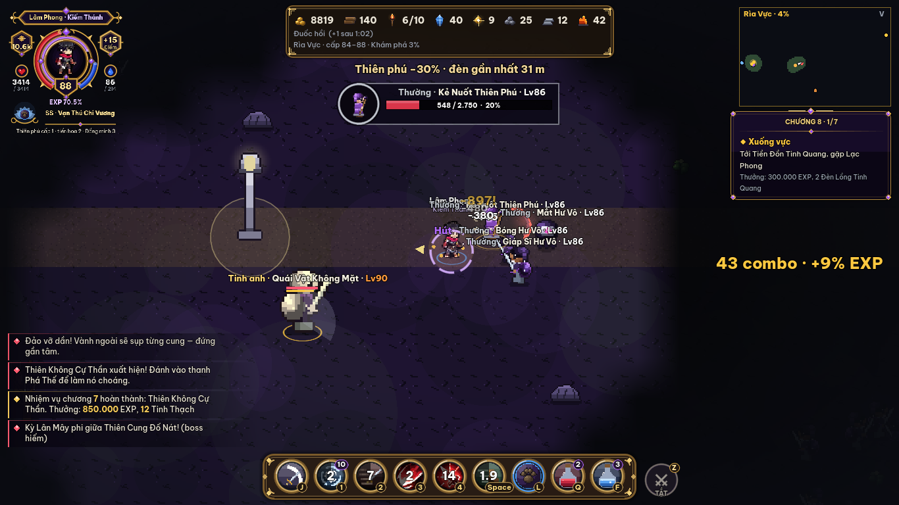
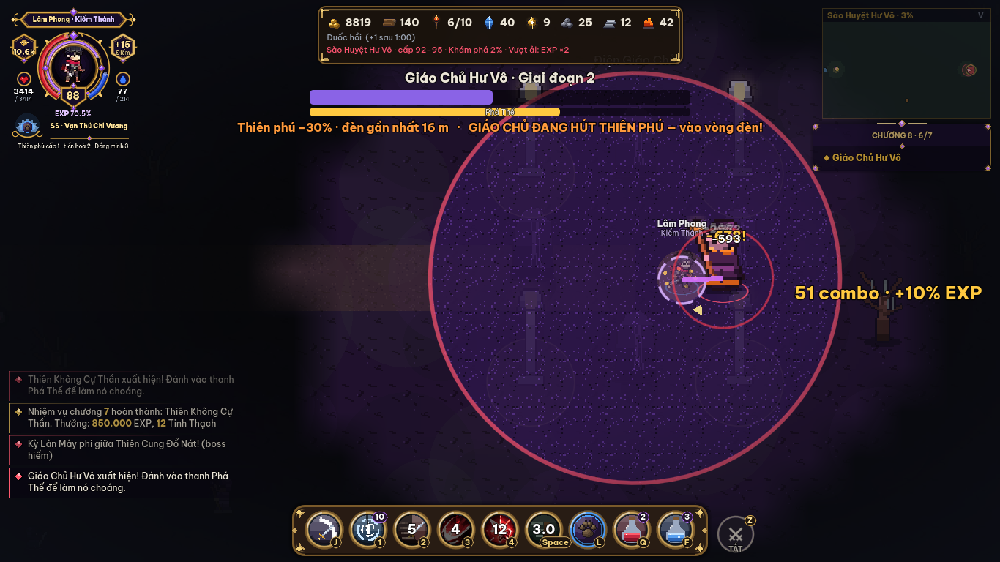

# Đợt M11 — Chương 8: Vực Hư Vô (vùng 8) + Chuyển chức 3

| | |
| --- | --- |
| Dự án | Thiên Phú Khai Giới |
| Nguồn | [Kịch bản](kich-ban-game-thien-phu-khai-gioi.md) mục 2 (chương 8: *"Tấn công sào huyệt Hư Vô Giáo — kết chương: chuyển chức lần 3"*; phe Hư Vô Giáo *"nuốt Thiên phú của người khác để thành thần"*), mục 4 (cây chuyển chức: *Kiếm Thần · Thiên Lạc Xạ Thủ · Hiền Giả*, chuyển chức ở cấp 90), mục 5 (boss Giáo Chủ Hư Vô: *"Hút Thiên phú: vô hiệu hoá Thiên phú người chơi 10 giây"*), mục 6 (vùng 8: *"Hư Vô (không hệ) · Thiên phú yếu dần theo thời gian — mở: Thiên phú tiến hoá 2 lần"*) · [06](06-ban-do-quai-boss.md) vùng 8 (**giữ nguyên tên và danh sách**) · [13](13-he-ky-nang.md) (khung kỹ năng, kỹ năng theo chức) · [16](16-chuong-7.md) (mồi chương 8, Q76 Lõi Hư Vô) · [12](12-chuong-5.md) (chuyển chức 2, Công Trại) |
| Mục tiêu | Chương 8 chơi trọn từ lúc vào Vực Hư Vô tới **chuyển chức 3** (điều kiện mở vùng 9) |
| Thứ tự | Sau M10 (chương 7). Chia M11.1 (vùng, Suy Thiên, quái) → M11.2 (boss, đồ) → M11.3 (cốt truyện, Tổng tấn công, chuyển chức 3) |
| Kiến trúc | `core/chapter8.gd` gắn qua `core/chapters.gd`. **Hook mới (đề xuất D48)**: `talent_mult(w) -> float` — hệ số hiệu lực Thiên phú (Suy Thiên, Hút Thiên phú), đọc ở một chỗ duy nhất trong `Talents` (giá trị hiệu ứng chính/phụ, thưởng chung theo cấp hiệu dụng) và hồi chiêu phím L. Vẽ ở `view/region8_view.gd`, hình `tools/art/region8.py` |
| Quy trình | Spec (file này) → duyệt → code → test → cập nhật 01/02/03/04/05/06/07 và mục Kết quả |
| Trạng thái | ✅ **Đã code 31/10/2026** (phiên game-3f) sau khi rà lại spec (mục 0b). Q83–Q89 dùng cột Mặc định (04 mục 13 dòng 14). Kết quả: mục 10 |

Ký hiệu: ✅ xong · 🟡 một phần · ⬜ chưa làm.

## 0. Bám kịch bản và các điều chỉnh mới

| Nguồn | Áp vào chương 8 |
| --- | --- |
| Kịch bản chương 8 | *"Tấn công sào huyệt"* → bước 5 **Tổng tấn công** (Công Trại đảo chiều: người chơi + quân Liên minh công cổng Sào Huyệt) |
| Kịch bản phe Hư Vô Giáo | Thiên phú bị nuốt được **giải phóng** khi hạ Giáo Chủ (kết chương) — khép tuyến Lam Nhi (chương 4) |
| Kịch bản mục 6 *"Thiên phú yếu dần"* | **Suy Thiên** (C8-10) — một hệ số duy nhất qua hook `talent_mult` (không sửa từng Thiên phú) |
| Kịch bản mục 4 | Chuyển chức 3 **hợp hai nhánh chức 2 về một chức** mỗi lớp (cây kịch bản: *Kiếm Thánh / Huyết Kiếm → Kiếm Thần*) |
| Q76 (spec 16) | **Lõi Hư Vô** = vật phẩm chuyển chức 3 (không dùng nâng Hoàng Thành) |
| SK1–SK3 | Chuyển chức 3 mở **1 Thần Kỹ** chủ động mỗi lớp, dùng khung kỹ năng có sẵn (cấp kỹ năng, biến thể 3 tầng, Bí Kíp) — mốc *"job3"* mới trong `classes.gd` |
| HP-01…10 | Hang phụ **Khe Hư Vô** ở 3 map; Suy Thiên **không** áp trong hang (HP-10) |
| MP-09 | Cổng "next" ở 7-3 thành **Khe Vực** (cổng đen tím) — mở khi đủ C8-01 |
| UI-15 / UI-16 / UI-17 | Bảng tên quái có sẵn (Bóng Hư Vô tàng hình thì ẩn bảng tên); mục tiêu nhiệm vụ ≤ 30 ký tự; thêm mẹo F1: *"Vực Hư Vô: Thiên phú yếu dần — đứng cạnh Đèn Tinh Quang 5 giây để hồi."* |
| D41, F1–F4 | Không có bất tử theo đồng hồ; hình phạt theo đòn có hồi chung; vật thể "phải đánh từ sau" có ngoại lệ cho đòn vùng (Q84) |

## 0b. Rà lại 31/10/2026 — các thay đổi sau ngày viết spec (22/10)

Spec viết khi game có 3 lớp, save v16, bản đồ cũ. Từ đó đã có thêm 2 lớp, chức 3, kỹ năng bị động, chỉ số mới, Bí Kíp mới, bản đồ ×3. Bảng dưới ghi thay đổi nào **sửa spec này** và sửa ở đâu. Chỗ đã sửa trong các mục sau được đánh dấu *(rà 31/10)*.

| Thay đổi (tài liệu) | Ảnh hưởng tới chương 8 | Sửa ở |
| --- | --- | --- |
| **5 lớp** — Hộ Vệ, Triệu Hồi Sư ([19](19-lop-ho-ve-trieu-hoi-su.md), [21](21-thiet-ke-lai-5-lop.md)) | 5 Tổ Sư thay cho 3; test cân bằng chạy 5 lớp | C8-40, C8-45, TL-B8, TL-J3 |
| **Chuyển chức 3 đã code** cho 5 lớp ([23](23-chuyen-chuc-3-linh-thu-co-mau.md), save v18) — bản tạm Q140 ở Liệt Diễm | M11.3 chỉ **bật điều kiện chương 8** (`Classes.JOB3_NEED_CH8 = true`: hạ Giáo Chủ + 3 Lõi Hư Vô) và chuyển nơi chuyển chức sang 5 Tổ Sư. Số liệu chức 3 / Thần Kỹ lấy theo docs/23 (đã cân bằng), không theo bảng cũ ở C8-46. Nhân vật **đã chuyển chức 3 bằng bản tạm thì giữ nguyên** | C8-45, C8-46, C8-47, mục 6 |
| **Linh thú có máu** (SH, docs/23 mục 4) | Quái thường vùng 8 đánh được linh thú; **Giáo Chủ, Hư Vô Thú và quái gọi trong trận boss không đánh linh thú** (SH-03). Lính Liên minh ở Tổng tấn công dùng khung đồng minh có máu | C8-42 |
| **Kỹ năng bị động** (PV, [27](27-ky-nang-bi-dong.md)) | Bị động là kỹ năng lớp, **không phải Thiên phú** → không bị Suy Thiên, không bị Hút Thiên phú | C8-10 |
| **7 thuộc tính + hệ số mới** (CS, [26](26-build-lop.md)) | Thang chỉ số cuối giữ nguyên → giữ công thức quái của 06 | — |
| **Bí Kíp = +1 Điểm Kỹ Năng** (BK, [29](29-bi-kip-diem-ky-nang.md), save v24) | Không còn "Bí Kíp tầng II/III"; rơi **Bí Kíp** (+1 Điểm Kỹ Năng), giữ tỉ lệ theo nguồn (boss chương 40%, boss hiếm 100%) | C8-31, C8-34 |
| **Bản đồ ×3 diện tích** (SN11-03, `Maps.MAP_SCALE = √3`, save v23) | Dữ liệu map viết theo toạ độ gốc 4.480 × 2.560 → trong game **7.760 × 4.434**. Giữ số đèn cũ thì đèn thưa gấp 1,7 lần → **tăng số đèn** 8/5/3 → **12/8/5**. Bán kính đèn, vùng an toàn, hang boss giữ nguyên (như SN11-03) | C8-02, C8-11 |
| **Bãi quái theo cấp** (SN9-06), **EXP theo chênh cấp** (SN9-05) | Áp tự động cho vùng 8 | — |
| **Bình MP** (SN10-02) | Tuyết Nga bán cả bình MP | C8-40 |
| **Khung mục tiêu** (SN9-09) | Bóng Hư Vô đang tàng hình không hiện ở khung mục tiêu | C8-20 |
| `Ch6.MIRROR_OF` đã có mọi kỹ năng 5 lớp + Thần Kỹ; kỹ năng lạ rơi về kiểu đạn (J3 Q145) | C8-51 coi như **đã đạt**; Ma Tôn GĐ2 (chương 9) dùng lại bảng này | C8-51 |
| Ám Khí ([14](14-chuong-6.md)) chỉ chạy ở vùng 6 | Ở vùng 8 Ám Khí **chỉ tăng khi bị Hút Thiên phú** (+25), không tăng theo giao tranh; đầy → Ám Hoá 6 giây như chương 6 | C8-15 |
| Save đã tới **v24** | M11 dùng **v25** (thay v19) | mục 6 |
| RS-E02 / Q104 "Bùa Vùng" (rà soát docs/19) — **chưa duyệt** | Giữ **Đèn Lồng Tinh Quang** phím Q như chương 4–7. Nếu sau này duyệt Bùa Vùng thì Đèn Lồng thành một hiệu ứng của Bùa | C8-14 |

## 1. Mở vùng 8

| Mã | Yêu cầu | Tiêu chí |
| --- | --- | --- |
| C8-01 | Điều kiện (kịch bản mục 6): **Thiên phú đã tiến hoá 2 lần** (`profile.evo >= 2`; Đạo Tặc coi như đạt; Đột Phá C7-44 tính) + **hạ Thiên Không Cự Thần** + **cấp ≥ 83**. Cổng Khe Vực ở 7-3 + bảng Cổng Dịch Chuyển hiện điều kiện còn thiếu | C8-T1 |
| C8-02 | 3 map (toạ độ gốc 4.480 × 2.560; trong game ×√3 = 7.760 × 4.434 — SN11-03 *(rà 31/10)*), sương che: **8-1 Rìa Vực** (cấp 84–88, trạm *Tiền Đồn Tinh Quang* — 3 NPC, **12** Đèn Tinh Quang), **8-2 Đáy Vực** (88–92, trạm *Hố Lửa Thánh*, **8** đèn — 4 đèn tắt chờ thắp ở bước 3), **8-3 Sào Huyệt Hư Vô** (92–95, trạm *Cổng Phá Vây* — **chỉ thành vùng an toàn sau bước 5**, **5** đèn, hang *Điện Giáo Chủ* cấp 93, boss hiếm Hư Vô Thú). Đi 8-1 → 8-2 → 8-3 | C8-T1; smoke `19-region8` |
| C8-03 | Lưới khai phá 45 ô (06: *"Không có tài nguyên thường; khai phá cho Tinh Thạch ×3"*): ô sự kiện Tài nguyên đổi thành **Mạch Tinh Thạch** (chiếm ô: +10 Tinh Thạch một lần, không xây công trình); mọi ô khác khi chiếm thêm **+3 Tinh Thạch**. Không có Mỏ/Xưởng Gỗ ở vùng 8 | C8-T6 |
| C8-04 | Hang phụ **Khe Hư Vô** (HP-02) ở cả 3 map | C8-T1 |

## 2. Môi trường Vực Hư Vô (M11.1)

| Mã | Yêu cầu | Tiêu chí |
| --- | --- | --- |
| C8-10 | **Suy Thiên — Thiên phú yếu dần** (kịch bản; 06): thanh 0–50%. Ở trong vực (ngoài vùng an toàn, ngoài vòng đèn) **mỗi 60 giây +10%** (tối đa 50%). Hiệu lực Thiên phú = **× (1 − Suy Thiên)**: hiệu ứng chính, hiệu ứng phụ có số, thưởng chung theo cấp hiệu dụng; **hồi chiêu phím L × (1 + Suy Thiên)**. Hiệu ứng bật/tắt (ví dụ Mắt Ưng thấy tàng hình) giữ nguyên tới khi Suy Thiên = 50% thì tắt. Qua hook `talent_mult` (D48). **Cách nhân** *(rà 31/10)*: giá trị hiệu ứng dạng phần cộng thêm (+10% chí mạng, hồi 30% HP, 3 lính bóng…) × k; dạng hệ số nhân ≥ 1 (×2,0 sát thương, ×1,5 tầm) chỉ phần vượt 1 × k; hồi chiêu Hiệu Triệu không giảm theo k. k = 0 (bị Hút) → mọi hiệu ứng Thiên phú tắt, kể cả hiệu ứng phụ bậc 5/10 (`Talents.has_sub`). **Kỹ năng bị động (PV) và chức nghiệp không bị ảnh hưởng** | C8-T2 |
| C8-11 | **Đèn Tinh Quang** (06): cột đèn trắng vàng, vòng sáng 6 m. Đứng trong vòng **5 giây liên tục** → Suy Thiên **về 0**; trong vòng Suy Thiên không tăng. Đèn thưa dần theo map (12 → 8 → 5 *(rà 31/10)*). HUD dòng môi trường: *"Thiên phú −30% · đèn gần nhất 42 m"* + mũi tên nhỏ chỉ đèn ở mép màn hình khi Suy Thiên ≥ 30% | C8-T2 |
| C8-12 | **Không hệ** (06): quái vùng 8 hệ `hu-vo` — **khắc hệ không áp** cả hai chiều (biến thể tầng II **vẫn có hiệu ứng phụ** thiêu/chậm/hút máu/xuyên giáp/Phá Thế nhưng không có +30%; Bí Kíp Âm Dương không có tác dụng). Biểu tượng hệ (UI-13) vẽ vòng rỗng tím | C8-T2 |
| C8-13 | **Cột Đá Hư Vô**: vật cản lớn rải trên map (6–10 cột/map), **chặn tầm nhìn** của Tia nhìn (C8-23) và đạn quái; người chơi nấp sau để tránh. Đạn người chơi cũng bị chặn (công bằng) | C8-T2 |
| C8-14 | **Đèn Lồng Tinh Quang** (vật phẩm mới, cửa hàng Tuyết Nga 150 vàng): phím **Q** → Suy Thiên về 0 + **miễn Suy Thiên 45 giây** (như Than Hồng C6-13) | C8-T2 |
| C8-15 | **Ám Khí phản kháng** (nối C6-42/43): ở vùng 8 Ám Khí của nhân vật (*mảnh thứ hai*) **không bị Suy Thiên**; mỗi khi Thiên phú bị vô hiệu (Hút Thiên phú, C8-30b) Ám Khí **+25** → dễ vào Ám Hoá (+20% Tấn công 6 giây). Ngoài lần bị hút, Ám Khí ở vùng 8 không tăng *(rà 31/10)*. Mồi cho lựa chọn kết thúc chương 9 | C8-T2 |

## 3. Quái vùng 8 (M11.1)

Chỉ số từ `Formulas.mob_stats` (06 vùng 8), hệ `hu-vo`.

| Mã | Quái | Loại | Kỹ năng | Tiêu chí |
| --- | --- | --- | --- | --- |
| C8-20 | **Bóng Hư Vô** | Nhanh | **Tàng hình khi đứng yên** quá 1 giây: mờ 15%, ẩn bảng tên và khung mục tiêu (SN9-09), **không bị tự ngắm** (`is_hidden`, F1 chương 6). Hiện khi di chuyển, khi bị đánh trúng, khi người chơi trong 5 m, hoặc người chơi có Mắt Ưng/Thiên Nhãn. **Đâm lén** (vung 0,4 s): ×1,8 nếu đứng **sau lưng** người chơi (ngoài nón 120° hướng mặt), ngược lại ×1,0 | C8-T3 |
| C8-21 | **Kẻ Nuốt Thiên Phú** | Phép | Đạn xa 18 m ×1,0, hồi 3 s. Trúng: **xoá 1 hiệu ứng có lợi** (ưu tiên Thiết Bích / Pháp Thuẫn / Ưng Nhãn / Ám Hoá / thuốc buff) và **Suy Thiên +5%** | C8-T3 |
| C8-22 | **Giáp Sĩ Hư Vô** | Giáp | **Chém nặng** (vung 1,0 s, hồi 6 s): nón 90° 5 m ×1,6 | C8-T3 |
| C8-23 | **Mắt Hư Vô** | Xa | **Tia nhìn**: khoá mục tiêu **1 giây** (tia mảnh báo), rồi **chiếu 3 giây** ×0,3 mỗi 0,2 s, hồi 6 s. Tia **bị chặn** bởi Cột Đá Hư Vô, đồng minh, phân thân (06: *"nấp sau vật cản để tránh"*). Không đuổi (đứng yên như loại Xa) | C8-T3 |
| C8-24 | Tinh anh **Tư Tế Hư Vô** (của Kẻ Nuốt Thiên Phú, từ cấp 88) | Phép | **Tế lễ** (hồi 15 s, **vung 1,5 s** — choáng/Phá Thế cắt được): hiến 1 quái thường gần nhất trong 12 m (quái đó chết, không EXP) → đồng bọn trong 12 m **hồi 30% HP + 30% Tấn công 10 giây** (hào quang đỏ tím). Không có quái để hiến thì không dùng | C8-T3 |
| C8-25 | Tinh anh **Quái Vật Không Mặt** (của Giáp Sĩ, từ cấp 90) | Lì | **Vô diện**: miễn sát thương từ **nón 120° phía trước** (chữ "Vô hiệu" xám); quay mặt **90°/giây** về người chơi; sau mỗi đòn đánh đứng yên 1,5 giây. Hướng đòn: đạn/chém tính từ hướng bay/vị trí người chơi; **đòn vùng có điểm rơi** (Mưa Tên, Thiên Thạch, Hoả Tường, bẫy, Thiên Tiễn Vũ…) và đồng minh/thú cưng **nhận 50%** từ mọi hướng (Q84). **Vỡ Phá Thế** → choáng 5 giây, nhận đủ sát thương mọi hướng | C8-T3 |

## 4. Boss và đồ (M11.2)

| Mã | Yêu cầu | Tiêu chí |
| --- | --- | --- |
| C8-30 | **Giáo Chủ Hư Vô** (boss chương 8, cấp 93, Hư Vô, 130 đòn; 125.184 HP theo 06) ở *Điện Giáo Chủ*: sảnh tròn 28 m, **4 Đèn Tinh Quang** ở 4 góc, 4 Cột Đá Hư Vô. Hình: người cao gầy áo choàng đen viền vàng, mặt nạ bạc, sau lưng xoay vòng **các đốm sáng Thiên phú bị nuốt** (màu theo hạng). Suy Thiên vẫn tăng trong điện. **GĐ1 (100 → 60%)**: **Phong ấn hư vô** (vung 1,0 s, hồi 8 s): vòng 10 m tại chỗ người chơi ×1,8 · **Tia hư vô** (vung 0,6 s, hồi 5 s): tia thẳng 25 m rộng 2 m ×1,2 (bị Cột Đá chặn) · đòn thường Trượng ×1,0 | C8-T4; TL-B8 |
| C8-30b | **GĐ2 (60 → 25%) — Hút Thiên phú** (kịch bản: *"vô hiệu hoá Thiên phú người chơi 10 giây"*): mỗi **30 giây** Giáo Chủ **kênh 1,5 giây** (dây tím nối tới người chơi, HUD *"Hút Thiên phú!"*) → Thiên phú người chơi **bị vô hiệu 10 giây** (`talent_mult` = 0: hiệu ứng tắt, phím L khoá; dạng tiến hoá bị "rút" khỏi khung nhân vật), Giáo Chủ **+15% Tấn công** trong 10 giây đó. **Tránh được**: lúc kênh kết thúc nếu người chơi đứng trong vòng một **Đèn Tinh Quang còn sáng** → đèn chặn đòn rồi **tắt vĩnh viễn** trong trận (4 đèn = 4 lần chặn). Ám Khí +25 mỗi lần bị hút (C8-15). GĐ1 tiếp tục | C8-T4 |
| C8-30c | **GĐ3 (dưới 25%)** (06): gọi **4 Tư Tế Hư Vô** (ở 4 góc, HP tinh anh cấp 92) + mỗi 10 giây gọi **2 Tín Đồ** (Bóng Hư Vô cấp 92, không tàng hình) làm vật tế. Mỗi lần một Tư Tế **tế lễ** xong (C8-24): Giáo Chủ **+10% Tấn công** (cộng dồn, tối đa +50%) thay cho hồi máu. Hút Thiên phú tiếp tục (mỗi 30 giây). Giáo Chủ **không bất tử** khi có Tư Tế (D41) | C8-T4 |
| C8-31 | Giáo Chủ rơi: 1 đồ Tím · 15% **Ấn Hư Vô** (nhẫn Cam: **miễn Suy Thiên**; Hút Thiên phú chỉ còn 5 giây) · 3 Tinh Hoa · 1 Tinh Kim · 15 Tinh Thạch · **Lõi Hư Vô**: lần đầu **3** (đủ chuyển chức 3), các lần sau 1 · 40% **Bí Kíp** (+1 Điểm Kỹ Năng — BK *(rà 31/10)*). Hồi sinh 10 phút | C8-T4 |
| C8-32 | **Đạo Tặc — Hút Thiên Phú** (06): quái trong 12 m **mất mọi tăng cường 6 giây** (hồi máu Tiên Gió, Tế lễ, Khiên trời, cuồng nộ boss), hút **10% HP hiện tại** của chúng (boss: 2%), hồi cho người chơi | C8-T4 |
| C8-33 | **Boss hiếm Hư Vô Thú** ở 8-3 (cấp 95, Lì, Hư Vô, 200 đòn; 188.514 HP; `RARE_BOSSES["8-3"]`; sau khi hạ Giáo Chủ). Ổ của nó có **4 Đèn Tinh Quang**. **Nuốt ánh sáng** (06): mỗi 20 giây vung 1,0 s rồi **tắt 1 đèn** (đèn gần người chơi nhất); trong trận Suy Thiên tăng **mỗi 30 giây** (gấp đôi). **Hàm hư vô** (vung 0,8 s, hồi 7 s): nón 60° 10 m ×2,0. Hết đèn → Hư Vô Thú **+20% tốc đánh** (thúc người chơi đánh nhanh) | C8-T4 |
| C8-34 | Hư Vô Thú rơi: **Nanh Hư Vô** (vũ khí Cam: bỏ qua **30% Phòng thủ** quái) · 1 Tinh Hoa Tiến Hoá · 5 Tinh Hoa · 1 Lõi Hư Vô · Bí Kíp (100%, +1 Điểm Kỹ Năng) | C8-T4 |
| C8-35 | **Bộ Tinh Quang** (đồ Tím vùng 8, 06): 2 — **Suy Thiên tăng chậm 50%** · 4 — +12% HP · 6 — **mỗi 60 giây miễn 1 lần bị vô hiệu Thiên phú** (Hút Thiên phú, C9 Ma Tôn GĐ3) | C8-T4 |

## 5. Cốt truyện và Tổng tấn công (M11.3)

| Mã | Yêu cầu | Tiêu chí |
| --- | --- | --- |
| C8-40 | **NPC Tiền Đồn Tinh Quang** (8-1): *Lạc Phong* (chỉ huy Liên minh Khai Giới từ chương 2 — dẫn quân tổng tấn công, người dẫn truyện) · *Tuyết Nga* (tư tế Thánh Đường, giữ Đèn Tinh Quang — **cửa hàng** Đèn Lồng Tinh Quang, bình máu, bình MP) · *Mạc Tam* (gián điệp Hư Vô Giáo chương 2, **xuất hiện từ bước 4** sau khi được cứu — chỉ đường). Sau bước 6, **5 Tổ Sư** đứng ở Cổng Phá Vây (C8-45 *(rà 31/10)*) | Smoke `19c-camp8` |
| C8-41 | **Nhiệm vụ chương 8 — 7 bước**: (1) **Xuống vực**: tới Tiền Đồn Tinh Quang gặp Lạc Phong · (2) **Mở đường**: hạ 30 quái vùng 8 · (3) **Thắp đèn**: tới Đáy Vực, thắp **4 Đèn Tinh Quang** tắt (đứng 3 giây; mỗi đèn vừa thắp kéo tới **1 đợt 5 Bóng Hư Vô**) · (4) **Lồng Hư Vô**: phá **3 Lồng Hư Vô** ở 8-2 (thanh bền = 20 × cấp, mỗi lồng có 1 Tư Tế + 4 quái canh); lồng cuối có **Mạc Tam** — bị giáo phái bỏ rơi, hối cải, chỉ lối vào Sào Huyệt · (5) **Tổng tấn công** (C8-42) · (6) hạ **Giáo Chủ Hư Vô** · (7) **chuyển chức 3** với Tổ Sư của lớp mình (C8-45). Thưởng EXP ≈ 25% EXP cấp 84 → 95 (24,78 triệu × 25% ≈ **6,19 triệu**), chia tăng dần | C8-T5 |
| C8-42 | **Tổng tấn công Sào Huyệt** (kịch bản chương 8; ngược với Công Trại C5-42): ở 8-3, cùng **4 Lính Liên minh** (đồng minh AI có máu — khung linh thú SH *(rà 31/10)*; HP = 40% HP người chơi, đánh ×0,3 Tấn công người chơi; không tính vào giới hạn linh thú của Triệu Hồi Sư) phá **3 Trụ Phong Ấn** canh cổng Sào Huyệt (mỗi trụ thanh bền = 60 × cấp). Phá mỗi trụ → **1 đợt phản công** (8 quái vùng 8 + 1 tinh anh). Thắng = phá đủ 3 trụ; thua = người chơi gục → làm lại từ trụ đang đánh (trụ đã phá giữ nguyên; bấm E với Lạc Phong). Thắng: trạm *Cổng Phá Vây* thành vùng an toàn + Cổng Dịch Chuyển. HUD: *"Tổng tấn công · trụ 2/3 · quân ta 3/4"* | C8-T6 |
| C8-43 | **Sau chương — Phản công Hư Vô** (như đột kích C5-43): mỗi 30 phút chơi ở vùng 8, một nhóm Hư Vô (8 quái + 1 Tư Tế) tấn công một Đèn Tinh Quang (báo trước 60 giây). Thắng: 15 Tinh Thạch. Bỏ qua/thua: đèn đó **tắt 30 phút** (chỉ ảnh hưởng Suy Thiên, không mất ô) | C8-T6 |
| C8-44 | **Kết chương 8**: hạ Giáo Chủ → mặt nạ vỡ, các đốm sáng Thiên phú bị nuốt bay đi khắp lục địa (*"trả về chủ cũ"*; Lam Nhi gửi thư cảm nhận được). Giáo Chủ hấp hối: Ma Tôn đã dùng mảnh Bia Đá gốc (C7-42) mở **Cổng Thiên Đạo**; "mảnh thứ hai" trong ngực nhân vật **đáp lời** — Ma Tôn gọi tên nhân vật (mồi chương 9). Từ trong điện, **5 Tổ Sư** — tàn hồn Khai Giới Giả đời đầu bị giam (nối di tích chương 3) — hiện ra. Màn kết chương | Smoke `20-chapter8-end` |
| C8-45 | **Chuyển chức 3** (kịch bản mục 4, cấp 90; NV-07): điều kiện **cấp 90 + đã chuyển chức 2 + hạ Giáo Chủ + 3 Lõi Hư Vô + 50 Tinh Thạch** (`JOB3_NEED_CH8 = true`; bỏ bản tạm Q140 của docs/23 — Liệt Diễm chỉ đường tới Cổng Phá Vây; ai đã chuyển chức 3 bằng bản tạm giữ nguyên). NPC *(rà 31/10)*: *Kiếm Tổ Vô Danh* (Kiếm Khách) · *Tiễn Tổ Lạc Nhật* (Thợ Săn) · *Pháp Tổ Huyền Cơ* (Pháp Sư) · *Thuẫn Tổ Bàn Thạch* (Hộ Vệ) · *Linh Tổ Vạn Hồn* (Triệu Hồi Sư); Tổ Sư chỉ nhận lớp của mình. **Hai nhánh chức 2 hợp về một chức 3** (cây kịch bản). Mọi chức 3: **+10% HP và Tấn công** (cộng dồn chức 1 + 2 = +30%), giữ hiệu ứng chức 1 + chức 2, thêm 2 hiệu ứng bị động + **1 Thần Kỹ** (C8-46). Lưu ở trường riêng `profile.job3` (như D40) | C8-T7; TL-J3 |
| C8-46 | **Chuyển chức 3 — hiệu ứng và Thần Kỹ** — ✅ **đã code ở J3** cho 5 lớp, số liệu theo [23 mục 3](23-chuyen-chuc-3-linh-thu-co-mau.md) (đã cân bằng). Bảng dưới là thiết kế gốc của 3 lớp, giữ để đối chiếu. Thần Kỹ là kỹ năng chủ động trong `classes.gd` (`"unlock": 90, "job3": true`), lắp vào 4 ô như kỹ năng khác, có cấp kỹ năng 1–10 + biến thể 3 tầng + Bí Kíp (SK2/SK3). Icon viền bạc | C8-T7 |
| C8-47 | Giao diện: bảng chuyển chức 3 (1 thẻ — tên, mô tả, hình hào quang trắng bạc), tên chức ở HUD / bảng Chỉ số / khung nhân vật — ✅ J3 (`ui/job3_panel.gd`). M11 *(rà 31/10)*: bảng hiện thêm điều kiện chương 8 (Giáo Chủ, Lõi Hư Vô x/3) qua lý do khoá. Cây 3 chức ở màn chọn lớp (Q146) — ngoài M11 | Smoke `20b-job3` |

> **J3 (27/10/2026):** chuyển chức 3 đã code cho cả 5 lớp theo [23](23-chuyen-chuc-3-linh-thu-co-mau.md), gồm thêm Hộ Vệ và Triệu Hồi Sư. Điều kiện đang dùng **bản tạm** (Q140): Liệt Diễm, cấp 90 + chức 2 + 50 Tinh Thạch. Khi làm M11: bật `Classes.JOB3_NEED_CH8`, thêm điều kiện hạ Giáo Chủ + 3 Lõi Hư Vô, đặt 5 Tổ Sư ở Cổng Phá Vây. Save J3 là **v18**, nên M11 sẽ dùng v19 như bảng mục 6.

**C8-46 — chuyển chức 3 (thiết kế gốc 22/10; bản đang chạy: docs/23 mục 3):**

| Lớp | Chức 3 | Hiệu ứng 1 | Hiệu ứng 2 | Thần Kỹ (hồi · MP) |
| --- | --- | --- | --- | --- |
| Kiếm Khách | **Kiếm Thần** | Kỹ năng sát thương **+15%** | Vỡ Phá Thế: boss choáng **6 giây** (thay 5) và nhận thêm +20% (tổng +70%) | **Nhất Kiếm Khai Thiên** (30 s · 40): vung 0,5 s, vệt chém thẳng **40 m rộng 5 m ×5,0**, gấp đôi vào Phá Thế |
| Thợ Săn | **Thiên Lạc Xạ Thủ** | Phát bắn thứ 5 gọi thêm **1 mũi tên sao** rơi xuống mục tiêu ×1,0 | **+10% chí mạng** lên boss, boss hiếm, tinh anh | **Thiên Lạc Tinh Vũ** (30 s · 40): 8 mũi tên sao rơi lên **8 quái HP cao nhất trong 25 m** (ít quái thì dồn vào boss), mỗi mũi ×1,6 |
| Pháp Sư | **Hiền Giả** | **+30% hồi MP**, phép vùng +15% bán kính | Cứ 3 kỹ năng dùng → kỹ năng kế tiếp **không tốn MP, hồi chiêu −50%** | **Ngũ Hành Luân Chuyển** (30 s · 40): 6 giây có **5 cầu ngũ hành** quay quanh bán kính 5 m, mỗi cầu chạm ×0,8 mỗi 0,5 s; mỗi cầu một hệ (luôn có 1 cầu khắc hệ quái — ở vùng 8 không có khắc) |

## 6. Thay đổi save (version 24 → 25)

*(rà 31/10)* Save đã tới v24 (BK) nên **M11 = v25**. `job3` đã có từ v18 (J3), không thêm.

| Trường | Kiểu | Mặc định save cũ |
| --- | --- | --- |
| `quest.ch8`, `quest.kills8`, `quest.lamps8`, `quest.cages8`, `quest.pillars8` | int, int, Array[int], Array[int], Array[int] | 0, 0, [], [], [] |
| `void_cores` (Lõi Hư Vô) | int | 0 |
| `lanterns` (Đèn Lồng Tinh Quang) | int | 0 |
| `assault_play`, `lamp_off_until` | float, Dictionary đèn → giây chơi | 0, {} |

Suy Thiên, Hút Thiên phú, Ám Khí là trạng thái trong trận (không lưu).

## 7. Kiểm thử

| Mã | Kiểm |
| --- | --- |
| C8-T1 | Điều kiện mở vùng 8 (thiếu tiến hoá 2 / Cự Thần / cấp → Khe Vực báo lý do; Đạo Tặc và Đột Phá đạt); 3 map đúng cấp/kích thước; Cổng Phá Vây chỉ an toàn sau bước 5; Khe Hư Vô |
| C8-T2 | Suy Thiên +10%/60 giây tối đa 50%, hiệu lực Thiên phú × (1 − suy), hồi chiêu L × (1 + suy); đèn 5 giây về 0; không áp trong hang / vùng an toàn; không hệ (không +30%, hiệu ứng phụ vẫn có); Cột Đá chặn tia và đạn; Đèn Lồng; Ám Khí không bị suy và +25 khi bị hút |
| C8-T3 | Bóng Hư Vô tàng hình + không bị tự ngắm + Đâm lén sau lưng ×1,8; Kẻ Nuốt xoá buff + suy 5%; Chém nặng; Tia nhìn khoá 1 giây, bị cột chặn; Tế lễ (cắt được bằng choáng); Không Mặt miễn trước, đòn vùng 50%, vỡ Phá Thế nhận đủ |
| C8-T4 | Giáo Chủ 3 giai đoạn; Hút Thiên phú 10 giây mỗi 30 giây, đèn chặn rồi tắt, +15%; GĐ3 4 Tư Tế + Tín Đồ, +10%/lần tế tối đa 50%, không bất tử; Ấn Hư Vô; Lõi Hư Vô 3 lần đầu; Hút Thiên Phú (Đạo Tặc); Hư Vô Thú tắt đèn mỗi 20 giây, suy gấp đôi; Nanh Hư Vô; Bộ Tinh Quang 2/4/6 |
| C8-T5 | Nhiệm vụ chương 8 đủ 7 bước; EXP ≈ 6,19 triệu; Mạc Tam hiện từ bước 4 |
| C8-T6 | Tổng tấn công: 3 trụ, phản công mỗi trụ, đồng minh, thua giữ trụ đã phá; Phản công Hư Vô mỗi 30 phút, đèn tắt 30 phút; lưới 45 ô, Mạch Tinh Thạch +10, ô khác +3 |
| C8-T7 | Chuyển chức 3 khi có chương 8: thiếu Giáo Chủ / Lõi Hư Vô → bị chặn và ghi lý do; đủ → trừ 3 Lõi + 50 Tinh Thạch; Tổ Sư chỉ nhận lớp mình; Liệt Diễm không còn chuyển chức 3; save v25 + chuyển đổi v24 (hiệu ứng, Thần Kỹ đã kiểm ở J3-T1…T3) |
| TL-B8 | **5 lớp** *(rà 31/10)* × 20 Thiên phú (chức 2 hai nhánh luân phiên, bộ kỹ năng mặc định cấp 92, tiến hoá 2 lần Lv10, chưa chức 3) hạ Giáo Chủ (bot cấp 92, bộ đồ chuẩn cấp 92): F/S ≤ 25%, các lớp ≤ 25%, 0 lần chết. Bot đứng vào vòng đèn khi Giáo Chủ kênh (mô phỏng người chơi biết cơ chế) — chạy thêm 1 lượt **bot không biết đèn** để in mức chênh F/S khi bị hút đủ |
| TL-J3 | ✅ Đã chạy ở J3 với Thiên Không Cự Thần (docs/23 mục 8). M11 không chạy lại (Giáo Chủ là trận cơ chế, TL-B8 đã đo 5 lớp) |
| PACE-T5 | (`--only=PACE`) bot cày vùng 8 cấp 84 → 92: phút, số lần chết, Suy Thiên trung bình |

Smoke mới: `19-region8`, `19c-camp8`, `19d-giao-chu`, `19e-assault`, `20-chapter8-end`, `20b-job3`.

## 8. Đạo Tặc và hệ thống chung

| Mã | Yêu cầu |
| --- | --- |
| C8-50 | Kỹ năng Đạo Tặc sao chép (phím L) là Thiên phú → **bị Suy Thiên** (hồi chiêu) và **bị Hút Thiên phú** khoá |
| C8-51 | ✅ *(rà 31/10)* `Ch6.MIRROR_OF` đã có bản bóng cho mọi kỹ năng 5 lớp + 5 Thần Kỹ (LH1, LH2, J3 Q145); kỹ năng không có trong bảng rơi về kiểu đạn `m_bolt`. Không cần bảng theo nhóm; Ma Tôn GĐ2 (chương 9) gọi lại `Ch6.MIRROR_OF` |

## 9. Điểm cần duyệt

| # | Câu hỏi | Mặc định đề xuất |
| --- | --- | --- |
| Q83 | "Vô hiệu hoá Thiên phú 10 giây" mỗi 30 giây — Thiên phú mạnh (S/SS) chịu thiệt nhiều hơn F → lệch nguyên tắc "F/S ≤ 25%"? | Giữ đúng kịch bản nhưng **tránh được bằng Đèn Tinh Quang** (4 lần mỗi trận) — kỹ năng của người chơi quyết định, không phải hạng Thiên phú. TL-B8 kiểm cả bot không biết đèn |
| Q84 | Quái Vật Không Mặt "chỉ đánh được sau lưng" — lớp đánh xa khó vòng ra sau | Quay chậm 90°/giây + đứng 1,5 giây sau mỗi đòn; **đòn vùng có điểm rơi và đồng minh nhận 50%** mọi hướng; vỡ Phá Thế nhận đủ |
| Q85 | Lõi Hư Vô dùng làm gì (06 cũ: nâng Hoàng Thành) | Theo Q76: **chuyển chức 3** (3 Lõi, lần đầu hạ Giáo Chủ rơi đủ 3); sau đó dùng ở endgame (spec 18, Tái Thiết Lục Địa) |
| Q86 | Chuyển chức 3 hợp 2 nhánh chức 2 về 1 chức (kịch bản) — người chơi có mất kỹ năng nhánh? | **Không mất**: giữ hiệu ứng + 2 kỹ năng nhánh chức 2, chức 3 cộng thêm. Chỉ tên chức là chung |
| Q87 | Thần Kỹ thay cho "kỹ năng tối thượng thứ 2" — có cần ô thứ 5? | **Không** (Q66 giữ 4 ô) — Thần Kỹ lắp như kỹ năng thường; người chơi chọn bỏ 1 kỹ năng |
| Q88 | Tổng tấn công có quân Liên minh đồng minh — AI đồng minh đủ tốt? | Dùng khung đồng minh có sẵn (Xương Nô / thú cưng); quân ta chết không làm thua, chỉ là phụ trợ |
| Q89 | Mạc Tam (gián điệp chương 2) quay lại hối cải — có hợp tuyến truyện? | Có: chương 2 hắn chạy về Phủ Huyền Ảnh; chương 8 bị giáo phái nhốt làm vật tế → lý do hối cải; Lạc Phong (người bị hắn lừa ở chương 2) quyết tha — một cảnh nhân vật |

## 10. Kết quả (M11, 31/10/2026)

**Code:**

- `core/chapter8.gd` (mới) — toàn bộ chương 8, module của `Chapters`. Hook mới `talent_mult`, `talent_cd_mult` (D70) trong `core/chapters.gd`.
- `core/game_world.gd`: `tv()` nhân hiệu lực Thiên phú, hồi chiêu L × (1 + Suy Thiên), phím L khoá khi bị Hút, `RARE_BOSSES["8-3"]` Hư Vô Thú, Đạo Tặc sao chép `hut_thien` từ Giáo Chủ, cửa hàng `lantern`, Giáo Chủ không dùng luật "boss GĐ2 ở xa thì ẩn".
- `core/stats.gd` (`bonus.talent_k`), `data/talents.gd` (`Talents.suppressed`), `core/explore.gd` (Mạch Tinh Thạch), `core/job3.gd` + `data/classes.gd` (`JOB3_NEED_CH8 = true`, `JOB3_MASTERS`), `core/chapter5.gd` (Liệt Diễm chỉ đường), `core/profile.gd` (save v25).
- Dữ liệu: `data/maps.gd` (8-1, 8-2, 8-3; khoá `lamps`, `lamps_off`, `stones8`, `cages`, `seals`), `data/monsters.gd` (8 loại), `data/items.gd` (Bộ Tinh Quang, Ấn Hư Vô, Nanh Hư Vô), `data/story.gd` (`QUESTS8`, 26 đoạn thoại).
- Giao diện: `view/region8_view.gd` (mới), `view/world_view.gd`, `ui/shop_panel.gd` (Đèn Lồng), `ui/map_panel.gd` (Mạch Tinh Thạch).
- Hình: `tools/art/region8.py` (AR-65 — docs/07).

**Chỗ khác spec khi code:**

| Mục | Spec | Đã làm | Lý do |
| --- | --- | --- | --- |
| C8-30 chuyển giai đoạn | không nêu | **6 giây trung lập** ở 60% và 25% (không nhận, không gây sát thương) | TL-B8: trận ngắn (20–33 giây), chênh lớp 26% với 5 giây → 23% với 6 giây. Đã thử cho Giáo Chủ miễn sát thương lúc kênh Hút — Pháp Sư mất phép rơi chậm, bỏ |
| C8-30c Tư Tế | "ở 4 góc" | 4 **hướng chính** (giữa các đèn) | Tư Tế đứng ngay cạnh đèn thì người chơi đang tránh Hút Thiên phú bị kéo vào đánh Tư Tế; linh thú Triệu Hồi Sư đánh nhầm (GĐ3 24 giây → 7 giây) |
| C8-41 bước 4, C8-42 | Lồng 20 × cấp, Trụ 60 × cấp | Lồng = 7 × HP quái Lì cùng cấp, Trụ = 12 × | "20 × cấp" chỉ ≈ 1.800 điểm — vỡ trong 1 đòn ở cấp 90. Dùng cách tính như Neo Hư Vô chương 7 |
| C8-42 thua Tổng tấn công | bấm E với Lạc Phong để công lại | Tự công lại khi quay về gần trụ còn lại | Không cần thêm thoại / nút; thua = người chơi gục hoặc chạy xa mọi trụ |
| C8-20 Mắt Ưng | thấy tàng hình | thấy khi hiệu lực Thiên phú > 50% | Hợp với luật "hiệu ứng bật/tắt tắt khi Suy Thiên 50%" (C8-10) |
| C8-43 Phản công | 8 quái + 1 Tư Tế | như spec, giới hạn 120 giây sau khi quái tới | Spec không nêu khi nào là "thua" |

**Kiểm thử:** 6 test C8 (C8-T1…T7 gộp) và TL-B8 qua.

TL-B8 (bot cấp 92, chức 2 luân phiên, tiến hoá 2 lần Lv10, đồ xanh dương/xanh lá cấp 92; 5 lớp × 20 Thiên phú, 0 lần chết):

| Lớp | F | S | F/S chênh | Trung bình |
| --- | --- | --- | --- | --- |
| Kiếm Khách | 25,1 giây | 23,9 giây | 5% | 25,1 giây |
| Thợ Săn | 25,1 | 24,7 | 2% | 25,5 |
| Pháp Sư | 30,7 | 28,4 | 7% | 29,9 |
| Hộ Vệ | 30,6 | 27,7 | 10% | 30,5 |
| Triệu Hồi Sư | 33,5 | 30,5 | 9% | 32,8 |

5 lớp chênh **23%** (≤ 25%). Bot luôn vào kịp vòng đèn nên không lần nào bị Hút. Lượt "bot không biết đèn" (Q83) **chưa chạy**.

**Smoke:** `19c-camp8`, `19-region8`, `19d-giao-chu` (ở `docs/images/m11/`).

**Chưa làm:** smoke `19e-assault`, `20-chapter8-end`; PACE-T5; TL-B8 bản bot không biết đèn; Hiệu ứng chỉ kiểm `profile.talent == …` (không qua `tv` / `has_sub`, ví dụ Khứu Giác thấy rương) vẫn còn khi bị Hút (D70).
