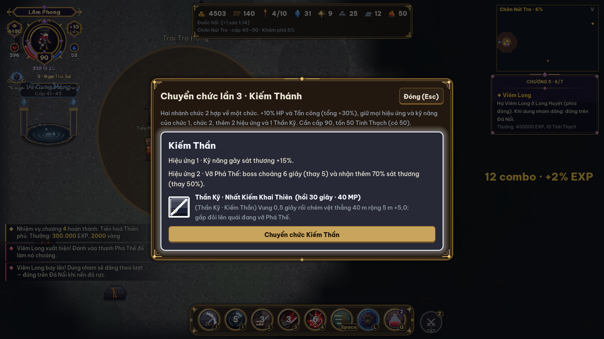

# Đợt J3 — Chuyển chức 3 (NV-07) cho 5 lớp + Linh thú có máu (Q112)

| | |
| --- | --- |
| Dự án | Thiên Phú Khai Giới |
| Nguồn | [Kịch bản](kich-ban-game-thien-phu-khai-gioi.md) mục 4 (cây chuyển chức: *Kiếm Thánh / Huyết Kiếm → Kiếm Thần*, *Thần Tiễn / Thợ Bẫy → Thiên Lạc Xạ Thủ*, *Đại Pháp Sư / Tử Linh Sư → Hiền Giả*, *Thánh Kỵ Sĩ / Thiết Vệ → Thủ Hộ Thần*) · [17](17-chuong-8.md) C8-45…C8-47, C8-51, TL-J3 · [19](19-lop-ho-ve-trieu-hoi-su.md) Q112, Q115 (Triệu Hồi Sư: *Vạn Linh Chi Chủ*) |
| Loại tài liệu | Đặc tả + kết quả. Yêu cầu chủ dự án 27/10/2026: *"Triển khai 2 mục Chưa làm: Chuyển chức 3. Linh thú có máu (Q112)."* Q140–Q146 theo mặc định. **Đã code** (mục 8) |
| Đợt | **J3** (chuyển chức 3) · **SH** (linh thú có máu) |

## 1. Phạm vi

- **J3**: chuyển chức 3 ở cấp 90 cho cả 5 lớp, lấy theo [17](17-chuong-8.md) C8-45, C8-46. Hộ Vệ và Triệu Hồi Sư chưa có trong spec 17, nên spec này thiết kế cho hai lớp đó (mục 3).
- **SH**: linh thú của Triệu Hồi Sư có HP. Quái thường và tinh anh có thể đánh linh thú; linh thú có thể gục.
- **Ngoài phạm vi**: chương 8 (Giáo Chủ Hư Vô, Lõi Hư Vô, 5 Tổ Sư). Chưa có chương 8, nên điều kiện chuyển chức 3 dùng **bản tạm** (Q140, mục 2).

## 2. Điều kiện và nơi chuyển chức (Q140)

| | Bản tạm (J3, làm bây giờ) | Khi có chương 8 (M11) |
| --- | --- | --- |
| Điều kiện | **Cấp 90** + đã chuyển chức 2 + **50 Tinh Thạch** | Thêm: hạ Giáo Chủ Hư Vô + 3 Lõi Hư Vô (C8-45) |
| NPC | *Liệt Diễm* ở Trại Tro Hồng (NPC chuyển chức 2, phím E) | 5 Tổ Sư ở Cổng Phá Vây (C8-40) |
| Code | `Classes.JOB3_NEED_CH8 := false` | Đặt `true`, `Job3.can_job3` kiểm thêm hai điều kiện |

- Chuyển chức 3 **không phải chọn nhánh**: mỗi lớp chỉ có 1 chức 3, hai nhánh chức 2 hợp về một (kịch bản).
- **Giữ nguyên** hiệu ứng chức 1, chức 2 và 2 kỹ năng nhánh chức 2 (Q86).
- Mọi chức 3 được **+10% HP và Tấn công**. Cộng với chức 1 và chức 2 là +30%.
- Mỗi chức 3 có thêm 2 hiệu ứng bị động và **1 Thần Kỹ**.
- Lưu ở trường `profile.job3`. Save tăng **v17 → v18**; save cũ nhận `job3 = ""`.

## 3. Năm chức 3

Mọi Thần Kỹ có hồi chiêu **30 giây**, tốn **40 MP** và mở ở **cấp 90** (`"unlock": 90, "job3": true`). Thần Kỹ:

- lắp vào 4 ô như kỹ năng thường; không có ô thứ 5 (Q87);
- có cấp kỹ năng 1–10, biến thể 3 tầng (bảng gây sát thương) và Bí Kíp;
- có icon viền bạc.

| Lớp | Chức 3 (`job3`) | Hiệu ứng 1 | Hiệu ứng 2 | Thần Kỹ |
| --- | --- | --- | --- | --- |
| Kiếm Khách | **Kiếm Thần** (`kiem-than`) | Kỹ năng gây sát thương **+15%** | Vỡ Phá Thế: boss choáng **6 giây** (thay 5) và nhận **+70%** (thay +50%) | **Nhất Kiếm Khai Thiên** (`nhatkiem`): vung 0,5 giây rồi chém một vệt thẳng **40 m, rộng 5 m, ×5,0**; gấp đôi lên quái đang vỡ Phá Thế |
| Thợ Săn | **Thiên Lạc Xạ Thủ** (`thien-lac`) | Cứ phát bắn thường thứ 5 gọi thêm **1 mũi tên sao** rơi xuống mục tiêu, **×0,5** *(cân bằng; spec 17: ×1,0)* | **+10% chí mạng** lên boss, boss hiếm, tinh anh | **Thiên Lạc Tinh Vũ** (`tinhvu`): 8 mũi tên sao rơi lên **8 quái nhiều HP nhất trong 25 m**, mỗi mũi **×0,7** *(cân bằng; spec 17: ×1,6)*; không đủ 8 quái thì các mũi còn lại dồn vào quái nhiều HP nhất. Mũi rơi cách nhau 0,1 giây |
| Pháp Sư | **Hiền Giả** (`hien-gia`) | **+30% hồi MP**; phép vùng (Bạo Phát Nguyên Tố, Thiên Thạch, Hoả Tường, Mưa Băng, vùng độc / băng) **+15% bán kính** | Cứ 3 lần dùng kỹ năng thì kỹ năng **kế tiếp không tốn MP và hồi chiêu −50%** | **Ngũ Hành Luân Chuyển** (`nguhanh`): trong 6 giây, **5 cầu ngũ hành** (Kim, Mộc, Thủy, Hỏa, Thổ) quay ở bán kính 5 m **quanh quái gần điểm ngắm nhất (trong 30 m)**; quái đó chết thì chuyển sang quái gần nhất; không có quái thì quay quanh mình *(cân bằng; spec 17: quanh mình — Pháp Sư đứng xa nên cầu không chạm boss)*. Mỗi quái nhận tối đa 1 đòn **×0,6** *(cân bằng; spec 17: ×0,8)* mỗi 0,5 giây. Nếu cầu khắc hệ quái đang chạm thì đòn +30% |
| Hộ Vệ | **Thủ Hộ Thần** (`thu-ho-than`) · Q141 | **Bất Khuất**: nhận ít hơn thêm **10%**. HP tụt dưới 30% thì hồi **30% HP** và **miễn sát thương 2 giây**; mỗi 60 giây một lần | **Thần Uy**: mỗi đòn trúng có **20%** làm choáng quái thường 1 giây; sát thương vào thanh Phá Thế **+50%** *(cân bằng; ban đầu +30%)* | **Thiên Thuẫn Giáng Thế** (`thienthuan`): khiên thần giáng xuống quanh người chơi — vòng **12 m ×5,5** *(cân bằng; ban đầu ×4,0)*, choáng 2 giây (boss / tinh anh: vào thanh Phá Thế ×2). Sau đó người chơi có **khiên chắn 30% HP tối đa** trong 6 giây |
| Triệu Hồi Sư | **Vạn Linh Chi Chủ** (`van-linh`) · Q142 | **Vạn Linh**: tối đa linh thú **+2** (thường 10, có Quân Đoàn 14); linh thú gọi bằng kỹ năng tồn tại lâu hơn **30%** | **Linh Hồn Bất Diệt**: linh thú **+15% sát thương** và **+50% HP**. Linh thú gục hoặc hết giờ thì nổ linh hồn vòng 5 m **×0,3** *(cân bằng; ban đầu ×0,6)*, tính theo kỹ năng đã gọi nó | **Kỳ Lân Giáng Thế** (`kylan`): gọi **Kỳ Lân Thần Thú** 12 giây — đánh xa 25 m, nổ lan 7 m, hệ số **×1,4** *(cân bằng; ban đầu ×2,2)*, HP = 100% HP người chơi, **không tính vào giới hạn**. Khi Kỳ Lân xuất hiện, mọi linh thú hồi đầy máu |

**Số liệu cân bằng:** xem mục 6. Số nào đổi khi cân bằng được ghi *(cân bằng)*.

## 4. Linh thú có máu (SH, Q112)

Mặc định cũ của Q112 là *"không có HP"*. Spec này đổi lại theo yêu cầu: **linh thú có HP**.

| Mã | Yêu cầu |
| --- | --- |
| SH-01 | Mỗi linh thú có **HP = tỉ lệ × HP tối đa người chơi** lúc gọi (bảng dưới) và **Phòng thủ = Phòng thủ người chơi**. Vạn Linh Chi Chủ: HP ×1,5 |
| SH-02 | **Quái chọn đánh linh thú**: quái thường (`field`, quái gọi thêm, quái Ổ quái) và tinh anh đang đuổi người chơi sẽ quay sang đánh linh thú gần nhất khi linh thú đó **gần quái hơn người chơi** và ở trong **8 m** của quái. Quái đứng lại và mỗi `windup + recover` giây đánh một đòn: `compute_damage(Tấn công quái, Phòng thủ linh thú, melee_mul)`. Có chớp sáng nhỏ ở linh thú và số sát thương màu tím |
| SH-03 | **Boss, boss hiếm và quái của trận boss không đánh linh thú** (Q143). Đòn vùng của boss cũng không trúng linh thú. Lý do: các trận boss được cân bằng theo người chơi (TL-B), đòn boss viết theo vị trí người chơi qua 7 chương; nếu cho trúng linh thú thì phải sửa hơn 40 kiểu đòn |
| SH-04 | Linh thú HP về 0 → **gục**: biến mất, hiện chữ *"Sói Bóng gục"*. Linh Hồ thường trực gục thì **10 giây sau** mới sinh lại (đổi map / người chơi hồi sinh → sinh lại ngay) |
| SH-05 | **Hồi máu**: linh thú không bị đánh 3 giây thì hồi 5% HP mỗi giây. Đứng trong vòng đồ đằng của Đồ Đằng Sư: hồi thêm 2%/giây. Thánh Vực, Linh Trận không hồi linh thú |
| SH-06 | Thanh máu nhỏ trên đầu linh thú, chỉ hiện khi bị mất máu |
| SH-07 | Thú cưng (Thuần Thú Sư), Xương Nô (Tử Linh Sư), Ảnh Phân Thân **giữ như cũ, không có HP** (Q144) |

| Linh thú | HP (× HP người chơi) |
| --- | --- |
| Linh Hồ / Hoả Hồ | 0,30 |
| Sói Bóng | 0,40 |
| Tiểu Quỷ | 0,15 |
| Thạch Quỷ | 0,80 — có **Khiêu Khích nhỏ**: quái trong 8 m ưu tiên Thạch Quỷ dù người chơi gần hơn |
| Linh Ưng | 0,25 |
| Linh Hồn (Quân Đoàn) | 0,15 |
| Ấu Long | 0,60 |
| Kỳ Lân (Thần Kỹ) | 1,00 |

## 5. Giao diện

| Mã | Yêu cầu | Kiểm |
| --- | --- | --- |
| J3-UI1 | Bảng chuyển chức 3 (`ui/job3_panel.gd`): 1 thẻ gồm tên chức, 2 hiệu ứng và Thần Kỹ (tên, mô tả), hào quang trắng bạc, nút *Chuyển chức*. Thiếu điều kiện thì nút khoá và ghi lý do | Smoke `20b-job3` |
| J3-UI2 | Tên chức 3 hiện ở HUD, bảng Chỉ số, bảng Kỹ năng và Nhật ký (`Classes.title(..., job3)`) | J3-T1 |
| J3-UI3 | Bảng Kỹ năng có tab **"Chức 3"** (tên chức 3 nếu đã chuyển). Chưa chuyển thì tab khoá với dòng *"Chuyển chức 3 ở cấp 90"* | J3-T3 |
| J3-UI4 | Nhân vật đã chuyển chức 3 có hào quang trắng bạc mờ dưới chân | Smoke |

## 6. Kiểm thử

| Mã | Kiểm |
| --- | --- |
| J3-T1 | Điều kiện (cấp 90, chức 2, 50 Tinh Thạch, đã chuyển rồi); `do_job3` trừ Tinh Thạch, +10% HP và Tấn công (tổng +30%), tên chức; Liệt Diễm trả `"job3"`; save v18 (save v17 → `job3 = ""`) |
| J3-T2 | 5 chức × 2 hiệu ứng (Kiếm Thần +15% / choáng 6 giây +70%; Thiên Lạc mũi sao thứ 5 / +10% chí mạng boss; Hiền Giả MP / bán kính / kỹ năng thứ 4 miễn phí; Thủ Hộ Thần −10% / Bất Khuất / Thần Uy; Vạn Linh giới hạn +2 / tồn tại +30% / +50% HP / nổ khi gục) |
| J3-T3 | 5 Thần Kỹ: khoá khi chưa chuyển chức 3, lắp ô, gây sát thương; Nhất Kiếm ×2 lên quái vỡ Phá Thế; Tinh Vũ 8 mũi; Ngũ Hành 5 cầu, cầu khắc +30%; Thiên Thuẫn choáng + khiên; Kỳ Lân không tính giới hạn, hồi đầy máu linh thú |
| SH-T1 | Linh thú có HP theo bảng; quái thường quay sang đánh linh thú gần nó hơn người chơi; Thạch Quỷ khiêu khích; boss không đánh linh thú; linh thú gục; Linh Hồ sinh lại sau 10 giây; hồi máu khi không bị đánh |
| TL-J3 | Mỗi lớp ở cấp 90 hạ Thiên Không Cự Thần (chương 7, boss mạnh nhất hiện có — thay Giáo Chủ cho tới M11). So chức 3 (có Thần Kỹ ở ô 4) với chức 2: chức 3 phải **nhanh hơn 8–20%**. Sau chức 3, các lớp chênh nhau **≤ 25%** |

## 7. Điểm cần duyệt

| Mã | Câu hỏi | Mặc định (đã dùng) |
| --- | --- | --- |
| Q140 | Chưa có chương 8 thì chuyển chức 3 ở đâu, điều kiện gì? | Liệt Diễm (Trại Tro Hồng); cấp 90 + chức 2 + 50 Tinh Thạch. Khi làm M11 thì bật `JOB3_NEED_CH8` và chuyển sang 5 Tổ Sư |
| Q141 | Thủ Hộ Thần (kịch bản chỉ có tên): hiệu ứng và Thần Kỹ? | Bất Khuất, Thần Uy, Thiên Thuẫn Giáng Thế (mục 3) — hợp vai đỡ đòn |
| Q142 | Vạn Linh Chi Chủ: hiệu ứng và Thần Kỹ? | Vạn Linh, Linh Hồn Bất Diệt, Kỳ Lân Giáng Thế (mục 3). Không dùng *"Vạn Linh Triều Bái"* vì tên đó đã gần với tối thượng Quân Đoàn (docs/21) |
| Q143 | Boss có đánh linh thú không? | **Không** (SH-03). Muốn có thì phải làm hệ mục tiêu cho từng kiểu đòn boss — đợt riêng |
| Q144 | Thú cưng, Xương Nô có HP luôn không? | **Không** — Q112 chỉ hỏi linh thú Triệu Hồi Sư |
| Q145 | Bản Ngã Bóng Tối (chương 6) có bản bóng của Thần Kỹ? | Thêm vào `Ch6.MIRROR_OF`, dùng kiểu bóng có sẵn gần nhất (Nhất Kiếm → kiếm khí, Tinh Vũ → mưa tên, Ngũ Hành → bạo phát, Thiên Thuẫn → chấn địa, Kỳ Lân → mưa). Chưa làm theo nhóm như C8-51 |
| Q146 | Sau chuyển chức 3, màn chọn lớp có ghi cây 3 chức (C8-47)? | Có — dòng *"Chức 3: …"* trên thẻ lớp. **Chưa làm**: phiên game-39 đang thiết kế lại màn chọn lớp (Spec_Notes đợt 8), làm sau để tránh sửa chồng |

## 8. Kết quả (J3 + SH, 27/10/2026)

**Code:**

- `core/job3.gd` (mới): module của `Chapters` — D58.
- `core/classes2.gd`: Thủ Hộ Thần, Vạn Linh Chi Chủ, Thiên Thuẫn, Kỳ Lân; linh thú có máu (`mob_vs_summon`, `damage_summon`, `summon_gone`) — D59.
- `data/classes.gd`: `JOBS3`, `job3_def`, `title(..., job3)`, 5 Thần Kỹ.
- `core/profile.gd`: save v18 (`job3`).
- `core/game_world.gd`: 5 lời gọi `Job3`; `Ally.hp/max_hp/hurt_t`; hook quái đánh linh thú.
- `core/chapter5.gd`: Liệt Diễm trả `"job3"`.
- `ui/job3_panel.gd` (mới), `ui/skill_panel.gd` (tab "Chức 3"), `view/job3_view.gd` (mới), `main.gd`.
- `tools/art/job3_icons.py` (mới), `catalog.py` (`ky-lan`).

**Kiểm thử:**

- J3-T1…T3 và SH-T1 qua.
- TL-J3 qua (bot cấp 90, đồ cấp 90, hạ Thiên Không Cự Thần; 4 Thiên phú × 2 lượt mỗi lớp, 0 lần chết):

| Lớp | Chức 2 | Chức 3 | Nhanh hơn |
| --- | --- | --- | --- |
| Kiếm Khách | 24,8 giây | 20,0 giây | 19% |
| Thợ Săn | 21,4 giây | 18,0 giây | 16% |
| Pháp Sư | 19,1 giây | 17,0 giây | 11% |
| Hộ Vệ | 25,5 giây | 20,6 giây | 19% |
| Triệu Hồi Sư | 22,5 giây | 18,2 giây | 19% |

Sau chức 3 các lớp chênh **18%** (chức 2: 25%). Lần chạy đầu: Thợ Săn +29%, Triệu Hồi Sư +28%, Pháp Sư +1% (cầu Ngũ Hành không chạm boss). Đã chỉnh các số ghi *(cân bằng)* ở mục 3.

**Smoke:** `20b-job3` — bảng chuyển chức 3 của Kiếm Khách.

**Chưa làm:**

- Điều kiện chương 8: Giáo Chủ, Lõi Hư Vô, 5 Tổ Sư (M11).
- Dòng cây 3 chức trên màn chọn lớp (Q146).
- Ảnh động riêng cho Thần Kỹ (đang vẽ bằng code).
- Boss đánh linh thú (Q143).
