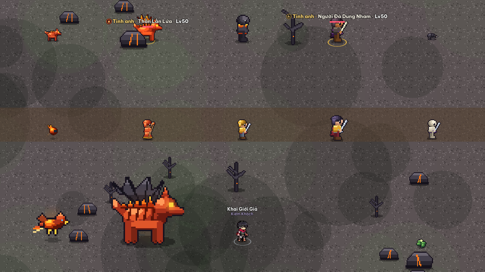
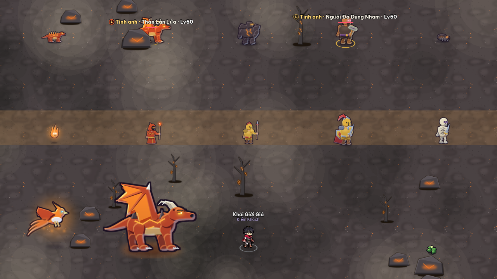
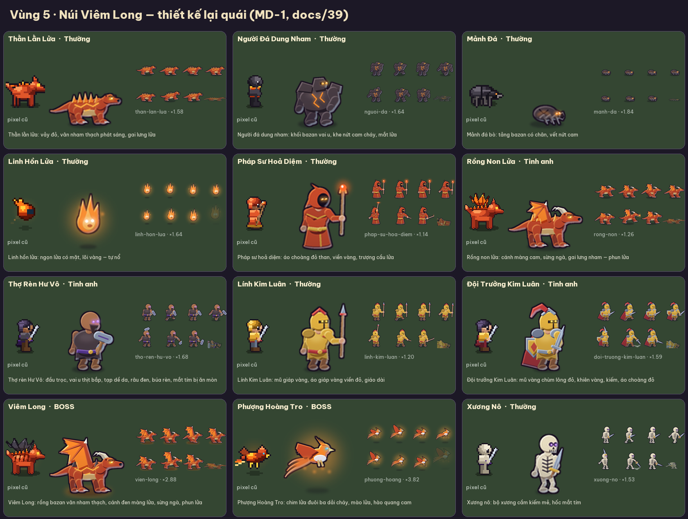

# 39. Thiết kế lại toàn bộ quái vật (MD-1)

| Mục | Nội dung |
| --- | --- |
| Ngày | 04/11/2026 |
| Yêu cầu | Chủ dự án: "Hãy nghiên cứu https://www.pinterest.com/pin/1132655375024680289/, và design lại toàn bộ quái vật trong game giúp tôi (cần design thành agent skills thì hãy làm nhé)" |
| Phạm vi | **85 quái / tinh anh / boss** của 9 vùng (mọi khoá `Monsters.DEFS` + mọi `elite_sprite`). **9 linh thú Triệu Hồi Sư** chỉ có bản duyệt, chưa đưa vào game (Q190). Không đụng nhân vật người chơi, NPC, hình / hiệu ứng kỹ năng ([keep-owner-art], [35 §8](35-de-xuat-giao-dien-moi.md)) |
| Lộ trình | Đây là giai đoạn **G3 — Quái, boss (UI-47)** của [35 §4](35-de-xuat-giao-dien-moi.md), làm theo hướng B (HD vector, code vẽ) đã chọn ở Q176 |
| Bản duyệt | [docs/design/monsters/](design/monsters/) — `vung-1.png` … `vung-9.png`, `vung-pet.png`: mỗi ô có hình pixel cũ (trái), HD idle (giữa), dải hoạt ảnh chạy / đánh / chết (phải), ý tưởng thiết kế (dưới) |
| Trong game | `godot/assets/hd/sprites/<id>.png` + lớp phủ `manifest["hd"]["sprites"]` — bật / tắt ở Cài đặt → "Đồ hoạ HD" (tắt = về hình pixel cũ) |
| Công cụ | `tools/art/hd/mon_kit.py`, `mon_biped.py`, `mon_beast.py`, `mon_misc.py`, `mon_catalog.py`, `mon_build.py`; skill **`.claude/skills/monster-design`** |
| Trạng thái | ✅ Đã làm và đưa vào game (04/11/2026) — **chờ chủ dự án duyệt ảnh** (§8). Không đạt thì tắt HD hoặc gỡ khỏi lớp phủ (§6.4) |

## 1. Ảnh mẫu

Pin là ảnh do người dùng tải lên (board "i" của Alejandro Ortega, 2 131 lượt lưu, không ghi nguồn), 735 × 1 140 px, nền đen. Lấy được qua API widget của Pinterest (`widgets.pinterest.com/v3/pidgets/pins/info/?pin_ids=…`), vì trang pin là trang JavaScript không đọc thẳng được.

Nội dung: một **bảng ~100 nhân vật / quái** vẽ tay kiểu cartoon cho game mobile (10 hàng × ~10 con): người thường (thợ, lính, nông dân), lính / hiệp sĩ có khiên, pháp sư trùm mũ, bộ xương, ma, quỷ có cánh, rồng, golem đá, người cây, nấm, slime, ếch, cá sấu, côn trùng, rắn, rương quái… Chỉ dùng làm **tham chiếu phong cách**; không chép nhân vật, tên hay dáng cụ thể nào của ảnh.

## 2. Phân tích phong cách (10 đặc điểm)

| # | Quan sát trên ảnh mẫu | Áp dụng cho game |
| --- | --- | --- |
| 1 | Mỗi con có **silhouette riêng**, nhận ra ngay cả khi thu nhỏ: sừng, mũ trùm nhọn, vũ khí to, cánh, bờm, đuôi | Quái trong game chỉ cao ~50–70 px trên màn hình → mỗi quái phải có 1 đặc điểm nhận diện từ xa (S1) |
| 2 | Tỉ lệ **chunky**: đầu to (≈ 1/3 người), vai rộng, bàn tay / bàn chân / vũ khí phóng đại, chân ngắn | Bộ dựng người `mon_biped`: đầu bán kính 10,5 trên thân 70 đơn vị; 3 kiểu thân normal / brute / thin |
| 3 | **Viền tối dày** quanh dáng, màu nâu-tím đậm chứ không đen tuyền; nét trong mảnh hơn | Viền `#1b1022` dày 2,4 đơn vị (≈ 2–3 px ảnh), nét trong (sọc, khe, vân) 0,7–1,4 |
| 4 | Đổ bóng **cel 2–3 tông**, chuyển mềm; bóng ngả lạnh (tím / lam), sáng ngả ấm (kem) | Dải màu `PAL`: mỗi màu là bộ 3 nền / bóng / sáng; bóng cel dời theo nguồn sáng trên-trái |
| 5 | **Đầu sáng, chân tối** — như có đèn rọi từ trên, nửa dưới chìm vào bóng | Chuyển sáng dọc tự động (`grad` 0,22) trong `Frame.render` |
| 6 | **Viền sáng ngược** (rim light) mảnh ở mép tối — tách nhân vật khỏi nền đen | Rim `#cfe4ff` mảnh ở mép dưới-phải, chỉ trên phần thân đặc |
| 7 | Mỗi con có **một màu nhấn phát sáng**: mắt, ngọc, lửa, độc, phép | `eye` / `orb` / `cracks` / `aura`, vẽ ở lớp riêng không viền, không bị tối theo (6) |
| 8 | Nhân vật trùm mũ / đội mũ giáp **giấu mặt, chỉ lộ 2 mắt sáng** — rất "quái" mà vẫn đơn giản | `head: hood / helm / shadow` cho lính đánh thuê, pháp sư, sát thủ, boss Hư Vô |
| 9 | **Họ màu theo phe**: cùng phe dùng cùng bảng màu bão hoà; con mạnh thêm vàng, vương miện, ánh sáng | Họ màu theo vùng / hệ (skill §2); tinh anh / boss có giáp vai vàng, vương miện, hào quang |
| 10 | Góc nhìn **3/4 từ trước**, đứng thẳng, tư thế sẵn sàng; chất liệu đọc rõ (thép bóng, vải mờ, xương, đá, lá) | Giữ quy ước game: 3/4 **quay phải**; chất liệu thể hiện bằng màu + chi tiết (sọc băng vải, xương sườn, khe nứt, gai) |

## 3. Quy chuẩn áp dụng

Quy chuẩn S1–S10 và họ màu từng vùng được ghi thành skill `.claude/skills/monster-design/SKILL.md` để mọi quái thêm sau này theo cùng phong cách. Tóm tắt:

- **Không gian thiết kế** 96 × 96 đơn vị, chân ở (0, 0), quay phải. Ba lớp: `back` (hào quang, khói), `body` (có viền, cel, rim, chuyển sáng), `front` (mắt, lửa, hạt phép).
- **Hoạt ảnh**: idle 4 · run 4 · attack 3 (lấy đà → ra đòn → thu) · hurt 2 (giật lùi + nháy sáng) · death 3 (ngã ngửa / sụp xuống / tan biến tuỳ dáng). Frame attack 0 luôn là tư thế lấy đà rõ ràng — khớp cửa sổ né `windup` và cảnh báo tự nhiên FX-1 §9.12.
- **Kích thước**: kích thước logic (w / px) **bằng bản pixel cùng id** (khung chân dung, khung mục tiêu không đổi). `size_mul` HD được tự hiệu chỉnh theo khung bao frame idle của bản pixel × 1,12, nên quái HD to tương đương bản pixel; vùng va chạm (`radius` trong `monsters.gd`) không đổi.
- **Độ nét**: ảnh vẽ siêu mẫu ×4 rồi thu Lanczos; độ phân giải tính theo **cỡ hiển thị thật sau hiệu chỉnh** (ảnh 1 frame ≥ w logic × 2 × `size_mul`) — boss lớn như Phượng Hoàng, Cự Thần, Viêm Long được vẽ tới ~384 px / frame.

## 4. Bảng thiết kế 94 con

Sinh từ `tools/art/hd/mon_catalog.py` (`python tools/art/hd/mon_build.py --doc`). Cột "Dáng" là bộ dựng.

| Vùng | id | Tên | Hạng | Dáng | Ý tưởng thiết kế |
| --- | --- | --- | --- | --- | --- |
| 1 | `wolf` | Sói Sương | Thường | beast | Sói xám lông xù, gáy dựng gai lông, mắt vàng hổ phách; dáng thấp sẵn lao |
| 1 | `mushroom` | Nấm Độc | Thường | mushroom | Nấm tím chấm kem có khuôn mặt cau có trên thân, chân ngắn lạch bạch, phun bào tử xanh |
| 1 | `wisp` | Tinh Linh Sương | Thường | spirit | Đốm hồn sương xanh ngọc, đuôi khói, mặt cười tinh nghịch |
| 1 | `moc-tinh` | Mộc Tinh | Thường | treant | Gốc cây biết đi: thân vỏ nứt, rêu xanh, mắt hốc phát sáng lục, tay cành |
| 1 | `nam-con` | Nấm Con | Thường | mushroom | Nấm con mũ cam chấm kem — nhỏ, nổ bào tử cam |
| 1 | `goc-re` | Gốc Rễ | Thường | treant | Gốc rễ nhỏ, tán lá thấp, mắt tím — trụ triệu hồi của Lão Thụ |
| 1 | `boss` | Sói Chúa Hư Vô | Boss | beast | Sói Chúa Hư Vô: lông tím than, bờm sư tử tím, sừng cong, khói Hư Vô bốc từ lưng, mắt hồng rực |
| 1 | `lao-thu` | Lão Thụ Sương Mù | Boss | treant | Lão Thụ Sương Mù: cổ thụ tán tím sương, quả đỏ độc, mắt đỏ, rễ cuộn lớn |
| 1 | `bach-ho` | Bạch Hổ Phong Vân | Boss | beast | Bạch Hổ Phong Vân: hổ trắng vằn than, bờm thép, mắt xanh gió, gió trắng quấn thân |
| 2 | `ung-gio` | Ưng Gió | Thường | bird | Ưng gió trắng cánh thép, mào nhọn, mắt đỏ — bổ nhào |
| 2 | `linh-danh-thue` | Lính Đánh Thuê Hư Vô | Thường | biped | Lính đánh thuê trùm mũ, mặt khuất bóng mắt tím, giáp vai sắt, áo choàng Hư Vô, kiếm |
| 2 | `doi-truong` | Đội Trưởng Đánh Thuê | Tinh anh | biped | Đội trưởng đánh thuê: mũ giáp chùm lông đỏ, giáp vai vàng, rìu lớn — xoáy rìu |
| 2 | `cung-thu` | Cung Thủ Thảo Nguyên | Thường | biped | Cung thủ thảo nguyên tóc nâu buộc, áo lá, cung gỗ lớn |
| 2 | `loc-xoay` | Lốc Xoáy Con | Thường | spirit | Lốc xoáy con trắng bạc có đôi mắt xếch — hút người chơi |
| 2 | `phu-thuy-gio` | Phù Thuỷ Gió | Tinh anh | biped | Phù thuỷ gió: mũ trùm tím, áo dài, trượng ngọc gió, gió nhẹ quanh chân |
| 2 | `huyen-anh` | Tướng Gián Điệp Huyền Ảnh | Boss | biped | Huyền Ảnh: gián điệp trùm mũ Hư Vô, khăn che mặt đỏ máu, áo choàng tím, kiếm mảnh |
| 2 | `huyen-anh-ao` | Bản sao Huyền Ảnh | Boss | biped | Bản sao Huyền Ảnh: giống hệt bản thật nhưng KHÔNG có bóng dưới chân (gợi ý kịch bản) |
| 3 | `bo-cat` | Bọ Cát | Thường | bug | Bọ cát vỏ đỏ gạch, hàm kìm, mắt vàng |
| 3 | `ran-cat` | Rắn Đồi Cát | Thường | serpent | Rắn đồi cát cuộn khoanh, bành mang, vảy đốm nâu |
| 3 | `xac-uop` | Xác Ướp Khai Giới | Thường | biped | Xác ướp băng vải ngả vàng, một mắt lục lộ qua kẽ băng, tay dài lê bước |
| 3 | `phap-su-cat` | Pháp Sư Cát | Thường | biped | Pháp sư cát áo choàng vàng cát, mắt cam trong mũ trùm, trượng cầu lửa |
| 3 | `bo-hung` | Bọ Hung Giáp Vàng | Tinh anh | bug | Bọ hung giáp vàng sừng cong — lăn húc |
| 3 | `thu-linh-xac-uop` | Thủ Lĩnh Xác Ướp | Tinh anh | biped | Thủ lĩnh xác ướp: vương miện vàng, áo choàng tím, trượng cầu tím — hồi sinh |
| 3 | `sa-hoang` | Bọ Cạp Sa Hoàng | Boss | bug | Bọ Cạp Sa Hoàng: vỏ nâu sẫm bóng, càng lớn, đuôi độc phát sáng lục |
| 3 | `nhan-su` | Nhân Sư Đá | Boss | beast | Nhân Sư Đá: thân sư tử cát, khăn nemes sọc vàng–lam, mắt lam phát sáng |
| 4 | `ech-doc` | Ếch Độc | Thường | frog | Ếch độc da lục đốm lam, mắt lồi vàng, túi cổ phồng — lưỡi dài |
| 4 | `dia` | Đỉa Hút Máu | Thường | serpent | Đỉa hút máu đỏ thẫm, miệng giác hút răng tròn |
| 4 | `hon-ma` | Hồn Ma Đầm | Thường | spirit | Hồn ma đầm: vải trắng rách, miệng há rên (hét) |
| 4 | `phu-thuy-dam` | Phù Thuỷ Đầm Lầy | Tinh anh | biped | Phù thuỷ đầm lầy: mũ trùm rêu, áo dài rách, trượng cầu độc lục — mưa độc |
| 4 | `ca-sau` | Cá Sấu Bùn | Thường | beast | Cá sấu bùn: thân dài thấp, gai lưng, mõm dài răng trắng |
| 4 | `ca-sau-chua` | Cá Sấu Chúa | Tinh anh | beast | Cá sấu chúa: to gấp rưỡi, vương miện vàng, mắt đỏ — cuộn tử thần |
| 4 | `nu-vuong` | Nữ Vương Phệ Mộng | Boss | biped | Nữ Vương Phệ Mộng: tóc bạc dài, vương miện, áo choàng tím mộng, trượng ngọc, hào quang tím |
| 4 | `mong-chau` | Mộng Châu | Thường | spirit | Mộng châu: ngọc tím xoáy sương, một mắt lơ mơ |
| 4 | `thuy-quai` | Thuỷ Quái Thất Đầu | Boss | serpent | Thuỷ Quái Thất Đầu: bảy cổ rắn biển vây lam mọc từ vòng nước |
| 4 | `dau-thuy-quai` | Đầu Thuỷ Quái | Thường | serpent | Đầu thuỷ quái: cổ rắn biển vây lam ngẩng lên phun nước |
| 5 | `than-lan-lua` | Thằn Lằn Lửa | Thường | beast | Thằn lằn lửa: vảy đỏ, vân nham thạch phát sáng, gai lưng lửa |
| 5 | `nguoi-da` | Người Đá Dung Nham | Thường | biped | Người đá dung nham: khối bazan vai u, khe nứt cam cháy, mắt lửa |
| 5 | `manh-da` | Mảnh Đá | Thường | bug | Mảnh đá bò: tảng bazan có chân, vết nứt cam |
| 5 | `linh-hon-lua` | Linh Hồn Lửa | Thường | spirit | Linh hồn lửa: ngọn lửa có mặt, lõi vàng — tự nổ |
| 5 | `phap-su-hoa-diem` | Pháp Sư Hoả Diệm | Thường | biped | Pháp sư hoả diệm: áo choàng đỏ than, viền vàng, trượng cầu lửa |
| 5 | `rong-non` | Rồng Non Lửa | Tinh anh | beast | Rồng non lửa: cánh màng cam, sừng ngà, gai lưng nham — phun lửa |
| 5 | `tho-ren-hu-vo` | Thợ Rèn Hư Vô | Tinh anh | biped | Thợ rèn Hư Vô: đầu trọc, vai u thịt bắp, tạp dề da, râu đen, búa rèn, mắt tím bị ăn mòn |
| 5 | `linh-kim-luan` | Lính Kim Luân | Thường | biped | Lính Kim Luân: mũ giáp vàng, áo giáp vàng viền đỏ, giáo dài |
| 5 | `doi-truong-kim-luan` | Đội Trưởng Kim Luân | Tinh anh | biped | Đội trưởng Kim Luân: mũ vàng chùm lông đỏ, khiên vàng, kiếm, áo choàng đỏ |
| 5 | `vien-long` | Viêm Long | Boss | beast | Viêm Long: rồng bazan vân nham thạch, cánh đen màng lửa, sừng ngà, phun lửa |
| 5 | `phuong-hoang` | Phượng Hoàng Tro | Boss | bird | Phượng Hoàng Tro: chim lửa đuôi ba dải cháy, mào lửa, hào quang cam |
| 5 | `xuong-no` | Xương Nô | Thường | biped | Xương nô: bộ xương cầm kiếm mẻ, hốc mắt tím |
| 6 | `soi-bang` | Sói Băng | Thường | beast | Sói băng lông tuyết, gai băng dọc gáy, mắt lam |
| 6 | `nguoi-tuyet` | Người Tuyết | Thường | biped | Người tuyết: khối tuyết vai u, gai băng trên đầu, mắt than lam |
| 6 | `tinh-linh-bang` | Tinh Linh Băng | Thường | spirit | Tinh linh băng: cụm tinh thể băng có mắt, phát sáng lam |
| 6 | `cung-thu-bang` | Cung Thủ Băng | Thường | biped | Cung thủ băng: mũ trùm lam sương, cung gỗ, mũi tên băng |
| 6 | `gau-bang` | Gấu Băng Khổng Lồ | Tinh anh | beast | Gấu băng khổng lồ: lông trắng dày, gai băng trên lưng, mắt lam |
| 6 | `phap-su-bao-tuyet` | Pháp Sư Bão Tuyết | Tinh anh | biped | Pháp sư bão tuyết: áo dài băng, áo choàng tuyết, trượng ngọc băng, bão nhỏ |
| 6 | `ban-nga` | Bản Ngã Bóng Tối | Boss | biped | Bản Ngã Bóng Tối: cái bóng của người chơi — thân tím than, mắt và miệng sáng tím, kiếm |
| 6 | `guong-bang` | Gương Băng | Thường | mirror | Gương băng: khung băng gai nhọn, mặt gương phản chiếu |
| 6 | `anh-bong` | Ảnh Bóng | Thường | biped | Ảnh bóng: bóng nhỏ, dao găm, mắt tím |
| 6 | `long-bang` | Long Băng Bắc Cực | Boss | beast | Long Băng Bắc Cực: rồng trắng băng, cánh màng lam, gai tinh thể, hơi thở băng |
| 7 | `dai-bang-may` | Đại Bàng Mây | Thường | bird | Đại bàng mây: lông trắng mây, cánh lam trời, mào vàng |
| 7 | `nguoi-go-dao` | Người Gỗ Đảo Bay | Thường | treant | Người gỗ đảo bay: tán lá ngọc, quả vàng, mắt lục nhạt |
| 7 | `tien-gio` | Tiên Gió | Thường | biped | Tiên gió: tóc lá dài, cánh chuồn trong suốt, bay lơ lửng, trượng lá |
| 7 | `hiep-si-thien-khong` | Hiệp Sĩ Thiên Không | Thường | biped | Hiệp sĩ thiên không: mũ thép chùm lông trời, áo choàng lam, giáo |
| 7 | `thu-ho-dao` | Thủ Hộ Đảo | Tinh anh | biped | Thủ hộ đảo: giáp đá cẩm thạch viền vàng, khiên trời, kiếm, hào quang vàng |
| 7 | `rong-may` | Rồng Mây | Tinh anh | beast | Rồng mây: thân ngọc, bờm mây, sừng gạc vàng, cánh mây, đuôi mây |
| 7 | `neo-hu-vo` | Neo Hư Vô | Thường | pylon | Neo Hư Vô: cột đá đen lơ lửng, vân tím, mảnh vỡ quay quanh |
| 7 | `cu-than` | Thiên Không Cự Thần | Boss | biped | Thiên Không Cự Thần: khổng lồ cẩm thạch, vai vàng, vết nứt sáng trời |
| 7 | `ky-lan-may` | Kỳ Lân Mây | Tinh anh | beast | Kỳ Lân Mây: ngựa ngọc một sừng vàng, bờm gai vàng, đuôi mây |
| 8 | `bong-hu-vo` | Bóng Hư Vô | Thường | biped | Bóng Hư Vô: sát thủ trùm mũ tím đen, dao găm — đâm sau lưng |
| 8 | `ke-nuot` | Kẻ Nuốt Thiên Phú | Thường | biped | Kẻ Nuốt Thiên Phú: pháp sư áo tím, mắt hồng, trượng cầu Hư Vô hút sáng |
| 8 | `giap-si-hu-vo` | Giáp Sĩ Hư Vô | Thường | biped | Giáp sĩ Hư Vô: mũ giáp sắt, khiên Hư Vô, giáp vai bạc |
| 8 | `mat-hu-vo` | Mắt Hư Vô | Thường | eye | Mắt Hư Vô: nhãn cầu lơ lửng, xúc tu tím, đồng tử hồng — bắn tia |
| 8 | `tu-te-hu-vo` | Tư Tế Hư Vô | Tinh anh | biped | Tư tế Hư Vô: áo dài đỏ máu viền vàng, trượng cầu máu, hào quang đỏ — hiến tế |
| 8 | `khong-mat` | Quái Vật Không Mặt | Tinh anh | biped | Quái vật không mặt: mặt nạ bạc trơn, khiên bạc, kiếm, hào quang xám |
| 8 | `long-hu-vo` | Lồng Hư Vô | Thường | pylon | Lồng Hư Vô: lồng song đá tím giam lõi sáng |
| 8 | `tru-phong-an` | Trụ Phong Ấn | Thường | pylon | Trụ phong ấn: cột cẩm thạch quấn xích, chữ ấn tím |
| 8 | `giao-chu` | Giáo Chủ Hư Vô | Boss | biped | Giáo Chủ Hư Vô: mũ trùm sâu, mặt nạ bạc, vương miện vàng, trượng sao, hào quang vàng |
| 8 | `hu-vo-thu` | Hư Vô Thú | Tinh anh | beast | Hư Vô Thú: mãnh thú tím than vằn hồng, bờm vực thẳm, sừng cong, gai tím |
| 9 | `thien-binh` | Thiên Binh Ngũ Hành | Thường | biped | Thiên binh ngũ hành: mũ vàng, giáp vàng quần ngọc, giáo |
| 9 | `tan-hon` | Tàn Hồn Khai Giới Giả | Thường | spirit | Tàn hồn khai giới giả: hồn ma lam bạc còn đội mũ giáp cũ của người khai giới |
| 9 | `thien-ma` | Thiên Mã | Thường | beast | Thiên mã: ngựa trắng cánh trắng, bờm vàng thiên, đuôi mây |
| 9 | `linh-thu-ngu-hanh` | Ngũ Hành Linh Thú | Thường | beast | Ngũ hành linh thú: sư tử vàng thiên, bờm ngọc, vằn lục, sừng gạc ngọc |
| 9 | `thien-tuong` | Thiên Tướng | Tinh anh | biped | Thiên tướng: giáp vàng thiên, mũ chùm lông đỏ, khiên vàng, kiếm, hào quang |
| 9 | `ngu-hanh-su-gia` | Ngũ Hành Sứ Giả | Tinh anh | biped | Ngũ hành sứ giả: lão nhân tóc râu bạc, áo ngọc, trượng tinh thể, hào quang |
| 9 | `ma-ton` | Ma Tôn Vô Diện | Boss | biped | Ma Tôn Vô Diện: ma vương không mặt, sừng bazan, giáp vai tím, áo choàng đen, kiếm Hư Vô |
| 9 | `ma-ton-ao` | Ma Tôn Vô Diện | Boss | biped | Ảo ảnh Ma Tôn: giống hệt bản thật (cơ chế đánh lừa) |
| 9 | `thien-dao-hu-anh` | Thiên Đạo Hư Ảnh | Boss | biped | Thiên Đạo Hư Ảnh: hư ảnh trắng bán trong suốt, tóc bạc dài, bay, trượng vàng |
| pet | `linh-ho` | Linh Hồ | Linh thú | beast | Linh hồ: cáo hồn xanh ngọc đuôi xù |
| pet | `hoa-ho` | Hoả Hồ | Linh thú | beast | Hoả hồ: cáo lửa đuôi cháy |
| pet | `soi-bong` | Sói Bóng | Linh thú | beast | Sói bóng: sói tím than mắt tím |
| pet | `tieu-quy` | Tiểu Quỷ | Linh thú | spirit | Tiểu quỷ: quỷ nhỏ tím sừng nhọn đuôi roi |
| pet | `thach-quy` | Thạch Quỷ | Linh thú | biped | Thạch quỷ: người đá xám, vân tinh thể lam |
| pet | `linh-ung` | Linh Ưng | Linh thú | bird | Linh ưng: chim hồn ngọc cánh tinh thể |
| pet | `linh-hon` | Linh Hồn | Linh thú | spirit | Linh hồn nhỏ xanh ngọc |
| pet | `au-long` | Ấu Long | Linh thú | beast | Ấu long: rồng con lửa, bờm vàng, cánh nhỏ |
| pet | `ky-lan` | Kỳ Lân | Linh thú | beast | Kỳ lân thần thú: ngựa trắng sừng vàng, bờm vàng, đuôi mây |

## 5. Ảnh duyệt

- [Vùng 1](design/monsters/vung-1.png)
- [Vùng 2](design/monsters/vung-2.png)
- [Vùng 3](design/monsters/vung-3.png)
- [Vùng 4](design/monsters/vung-4.png)
- [Vùng 5](design/monsters/vung-5.png)
- [Vùng 6](design/monsters/vung-6.png)
- [Vùng 7](design/monsters/vung-7.png)
- [Vùng 8](design/monsters/vung-8.png)
- [Vùng 9](design/monsters/vung-9.png)
- [Vùng pet](design/monsters/vung-pet.png)

**Trong game thật** (`godot/tests/md1_shot.gd --region=N [--hd=0]`, nền vùng + cây + chữ tên, cỡ thật): [docs/design/monsters/ingame/](design/monsters/ingame/) — `vung-<n>-hd.png` cho 9 vùng, `vung-5-pixel.png` để so cùng cảnh với hình pixel cũ.

| Pixel cũ | HD mới (MD-1) |
| --- | --- |
|  |  |



Nhận xét khi xem trong game: cỡ quái HD tương đương bản pixel (D85); quái Hư Vô tím trên nền vực tím vẫn tách nền nhờ viền tối + viền sáng ngược; quái thường vùng 1 nhỏ dễ bị tán cây che (đã có làm mờ cây khi che, FX-1 §9.13).

## 6. Kỹ thuật

### 6.1 File

| File | Vai trò |
| --- | --- |
| `tools/art/hd/mon_kit.py` | Khung chung: `PAL` (dải màu 3 tông), `Frame` (3 lớp, `part` / `flat` / `glow` / `eyes` / `shadow`, `render` = chuyển sáng dọc + rim + nháy trúng đòn + viền tối), hurt / death chung, `build()` → sheet + meta |
| `tools/art/hd/mon_biped.py` | Dáng người: 9 kiểu đầu (human, hood, helm, skull, mummy, stone, snow, shadow, faceless), 8 vũ khí, khiên, áo dài, áo choàng, giáp vai, cánh tiên, vương miện, sừng, bay lơ lửng |
| `tools/art/hd/mon_beast.py` | Thú 4 chân (tổng quát hoá từ Sói Sương G0): 7 kiểu đầu (canine, feline, bear, lizard, croc, horse, dragon), bờm, sừng, vằn, gai lưng, 6 kiểu đuôi, cánh dơi, khăn nhân sư, vân nham thạch |
| `tools/art/hd/mon_misc.py` | spirit (wisp, ghost, flame, crystal, tornado, orb, imp), mushroom, treant, bird (+ phượng hoàng), bug (+ bọ cạp, mảnh đá), serpent (rắn hổ mang, đỉa, thuỷ quái nhiều đầu), frog, mirror, pylon (anchor, cage, seal), eye |
| `tools/art/hd/mon_catalog.py` | 94 mục: builder + tham số + ý tưởng; `LIVE_EXCLUDE` = linh thú |
| `tools/art/hd/mon_build.py` | Dựng, hiệu chỉnh `px` / `size_mul`, ảnh duyệt, bảng §4 |
| `godot/tests/md1_shot.gd` | Chụp mọi quái của 1 vùng trong game thật (`--region=N --out=<png> [--hd=0]`), cần cửa sổ |
| `tools/art/hd/build_hd.py` | Gọi `mon_build.build_all` khi ghi lớp phủ HD (thay bước `wolf.py` cũ — file này giữ lại để so sánh, không dùng) |

### 6.2 Lệnh

```
python tools/art/hd/mon_build.py            # dựng + ảnh duyệt docs/design/monsters/ (không ghi manifest)
python tools/art/hd/mon_build.py ech-doc    # chỉ 1 con (ảnh duyệt vùng đó chỉ còn con này — dựng lại cả vùng trước khi gửi)
python tools/art/hd/build_hd.py             # ghi godot/assets/hd/sprites/*.png + manifest["hd"]
godot --headless --path godot --import
```

### 6.3 Trong game

Không đổi code game: `SpriteLib` đã có lớp phủ HD (UI-40). Mục HD có `px` = số px ảnh / 1 px logic (4 hoặc lớn hơn với boss), `size_mul` riêng; `draw_frame` chia tỉ lệ cho `px`. Lật hướng, `squash` / `lean` khi lấy đà (FX-1 §9.13), nháy trúng đòn, tô màu tinh anh vẫn do `world_view.gd` làm như với hình pixel.

### 6.4 Gỡ / tắt

- Người chơi: Cài đặt → "Đồ hoạ HD" tắt → toàn bộ quái về pixel.
- Dự án: bỏ id khỏi `mon_catalog.M` (hoặc thêm vào `LIVE_EXCLUDE`) rồi chạy lại `build_hd.py`.

## 7. Kiểm thử

| ID | Nội dung |
| --- | --- |
| MD1-T1 | Mọi khoá `Monsters.DEFS` + mọi `elite_sprite` có mục HD; cỡ logic HD = pixel; `size_mul` 0,6–4,5; ảnh 1 frame ≥ 90% cỡ hiển thị (không bị phóng mờ); texture nạp được, đủ 5 hàng hoạt ảnh không tràn ảnh; 9 linh thú KHÔNG có mục HD (Q190); tắt HD → về hình pixel |
| UI40-T1 | (có sẵn) lớp phủ HD, kích thước logic Sói Sương = pixel, mipmap + Linear |

Kết quả 04/11/2026: MD1-T1 qua; **toàn bộ bộ test 217/217 qua** (`run_tests.gd`).

## 8. Câu hỏi cho chủ dự án

| ID | Câu hỏi | Mặc định đang dùng |
| --- | --- | --- |
| Q190 | 9 linh thú Triệu Hồi Sư (Linh Hồ, Hoả Hồ, Sói Bóng, Tiểu Quỷ, Thạch Quỷ, Linh Ưng, Linh Hồn, Ấu Long, Kỳ Lân) là một phần kỹ năng — có thay bằng bản mới (ảnh `vung-pet.png`) không? | Chưa thay (giữ hình cũ) |
| Q191 | Phong cách quái mới (§2) đã đúng ý chưa? Cần chỉnh gì: độ dày viền, độ đậm bóng, tỉ lệ đầu / người, độ to so với nhân vật? | Như ảnh duyệt |
| Q192 | Sói Sương / Sói Chúa Hư Vô bản G0 (đã có trong game từ 03/11) cũng được vẽ lại theo bộ mới cho đồng bộ. Giữ bản mới hay quay về G0? | Bản mới |

## 9. Quyết định

| ID | Quyết định |
| --- | --- |
| D85 | Quái HD dùng chung **không gian thiết kế 96 đơn vị + 3 lớp + hurt / death dựng chung**; kích thước logic luôn = bản pixel, độ nét nằm ở `px`; `size_mul` tự hiệu chỉnh theo bản pixel (không chỉnh tay) để không lệch cảm giác va chạm / cân bằng |
