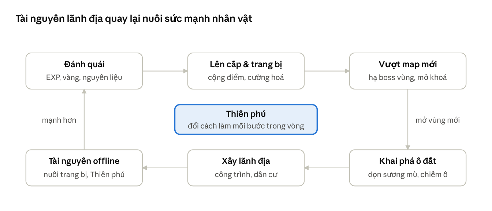

# Kịch bản Game: Thiên Phú Khai Giới

19/10/2026 · vinhnv.bg@gmail.com

> Bản gốc (chỉnh sửa, bình luận): https://claude.ai/code/artifact/fdcf0d89-4d42-4128-8ee5-2aa5514acae9

## 1. Tổng quan & research thể loại

**Thiên Phú Khai Giới** là game nhập vai hành động (ARPG) góc nhìn top-down 2.5D: người chơi nhận một Thiên phú ngẫu nhiên khi vào game, đánh quái lên cấp, vượt từng bản đồ và khai phá các vùng đất bị sương mù che phủ để mở rộng lãnh địa. Nền tảng đề xuất: PC + Mobile, chơi đơn là chính, có yếu tố online nhẹ (bảng xếp hạng, giao dịch, boss thế giới).

### Game tham chiếu và bài học rút ra

| Game | Cơ chế đáng học | Áp dụng vào dự án |
| --- | --- | --- |
| Diablo / Path of Exile | Loot ngẫu nhiên, affix trang bị, cây kỹ năng sâu | Hệ trang bị có affix, build đa dạng theo Thiên phú |
| MU Online | Lên cấp nhanh, cộng điểm tiềm năng, chuyển chức | Cộng điểm stat thủ công, 3 lần chuyển chức |
| Ragnarok Online | Bản đồ nối liền, quái theo vùng, MVP boss | Mỗi map có boss vùng và boss hiếm xuất hiện theo giờ |
| Solo Leveling: Arise | Cổng dungeon theo hạng, nhân vật thức tỉnh | Hạng Thiên phú F→SSS, sự kiện Thức tỉnh lại |
| Vampire Survivors / roguelite | Combat đơn giản, cảm giác mạnh lên liên tục | Quái đông, kỹ năng tự kích hoạt ở chế độ Thử luyện |
| Game tu tiên idle (Trung Quốc) | Cảnh giới, tài nguyên offline, Thiên phú/linh căn | Thiên phú như "linh căn", thu hoạch lãnh địa khi offline |
| Civilization / Northgard | Sương mù chiến tranh, khám phá ô đất | Vùng đất mới chia ô, dọn sương mù và chiếm cứ điểm |

### Xu hướng thể loại cần nắm

- Người chơi thích **khởi đầu ngẫu nhiên nhưng công bằng**: "gacha Thiên phú" lúc tạo nhân vật tạo cảm xúc mạnh, nhưng phải có đường để người nhận Thiên phú thấp vẫn vươn lên.
- Truyện "isekai / hệ thống / thức tỉnh" (webnovel, manhwa) rất phổ biến với người chơi Việt Nam — giao diện "bảng hệ thống" là điểm nhận diện tốt.
- Kết hợp **hành động chủ động + tiến trình idle** giúp giữ chân người chơi bận rộn.

### Điểm khác biệt của dự án

1. Thiên phú không chỉ là buff chỉ số mà **thay đổi cách chơi** và **ảnh hưởng cách khai phá** (ví dụ: Thiên phú "Mắt Ưng" nhìn xuyên sương mù).
2. Vượt map và khai phá là hai trục song song: vượt map để mạnh lên, khai phá để xây lãnh địa, tài nguyên lãnh địa quay lại nuôi nhân vật.
3. Thiên phú có thể **tiến hoá** qua cốt truyện, nên Thiên phú hạng thấp vẫn có lộ trình riêng.

Ghi chú: phần research dựa trên kiến thức chung về các game kể trên, chưa kèm số liệu thị trường; cần bổ sung nếu dùng để gọi vốn.

## 2. Thế giới quan & cốt truyện

Thế giới **Huyền Thổ** từng là một lục địa thống nhất, bị xé vụn thành chín vùng đất sau đại nạn **Thiên Liệt** cách đây 1.000 năm. Sương mù Hư Vô phủ kín các vùng đất, sinh ra quái vật; chỉ những người được Thiên Đạo ban Thiên phú — gọi là **Khai Giới Giả** — mới đủ sức xua tan sương mù và giành lại đất đai.

### Nhân vật chính

Người chơi là một thanh niên vô danh ở làng **Thanh Thạch**, ngôi làng cuối cùng bên bờ sương mù. Trong Lễ Thức Tỉnh tuổi 16, Bia Đá Thiên Đạo phát sáng và ban cho nhân vật một Thiên phú. Bí mật cốt lõi: nhân vật mang một **"mảnh Thiên phú thứ hai" bị phong ấn**, chỉ lộ diện ở chương cuối.

### Phe phái

| Phe | Mục tiêu | Vai trò với người chơi |
| --- | --- | --- |
| Liên minh Khai Giới | Giành lại đất, tái thiết lục địa | Giao nhiệm vụ chính, xếp hạng Khai Giới Giả |
| Thương hội Kim Luân | Kiểm soát tuyến giao thương giữa các vùng | Cửa hàng, đấu giá, nhiệm vụ hộ tống |
| Thánh Đường Tinh Quang | Bảo vệ Bia Đá Thiên Đạo | Thức tỉnh và tiến hoá Thiên phú |
| Hư Vô Giáo (phản diện) | Nuốt Thiên phú của người khác để thành thần | Kẻ thù xuyên suốt, boss chương |

### Phản diện chính

**Ma Tôn Vô Diện** — Khai Giới Giả mạnh nhất của 1.000 năm trước, chính là người gây ra Thiên Liệt khi cố đoạt Thiên phú của Thiên Đạo. Hắn không còn Thiên phú riêng nên phải cướp Thiên phú của người khác; "mảnh thứ hai" trong người nhân vật chính là mảnh linh hồn hắn đánh mất.

### Mạch truyện theo chương

| Chương | Vùng đất | Diễn biến chính | Kết chương |
| --- | --- | --- | --- |
| 1. Thức Tỉnh | Làng Thanh Thạch, Rừng Sương | Nhận Thiên phú, làng bị quái tấn công | Đánh bại Sói Chúa Hư Vô, lên đường tới thành |
| 2. Thành Biên Đài | Đồng Bằng Gió Hú | Gia nhập Liên minh, nhận lãnh địa đầu tiên | Phát hiện gián điệp Hư Vô Giáo trong thành |
| 3. Sa Mạc Lãng Quên | Sa Mạc Xích Sa | Truy tìm di tích của Khai Giới Giả đời đầu | Chuyển chức lần 1, biết về Thiên Liệt |
| 4. Đầm Lầy Mộng | Đầm Lầy U Minh | Bạn đồng hành bị đoạt Thiên phú | Cứu bạn, Thiên phú tiến hoá lần 1 |
| 5. Núi Lửa Phẫn Nộ | Núi Viêm Long | Thương hội phản bội, chiến tranh lãnh địa | Chuyển chức lần 2 |
| 6. Băng Nguyên Vĩnh Dạ | Băng Nguyên Bắc Cực | Mảnh Thiên phú thứ hai thức giấc, nhân vật mất kiểm soát | Biết sự thật về thân phận |
| 7. Thiên Không Đảo | Quần đảo bay | Tìm Bia Đá gốc để phong ấn lại | Thiên phú tiến hoá lần 2 |
| 8. Vực Hư Vô | Lõi sương mù | Tấn công sào huyệt Hư Vô Giáo | Chuyển chức lần 3 |
| 9. Thiên Đạo Chi Môn | Cổng Thiên Đạo | Quyết chiến Ma Tôn Vô Diện | Hai kết thúc (xem dưới) |

**Hai kết thúc:** (1) *Hợp nhất* — nhân vật hấp thụ mảnh thứ hai, trở thành Thiên Đạo mới, mở chế độ endgame "Thần Vực". (2) *Hiến tế* — nhân vật trả mảnh thứ hai cho Bia Đá, sương mù tan, mở chế độ endgame "Tái Thiết Lục Địa". Lựa chọn ảnh hưởng trục Thiên phú được mở ở endgame.

## 3. Hệ thống Thiên phú

Mỗi nhân vật nhận **1 Thiên phú chính** khi vào game qua Lễ Thức Tỉnh, được **quay lại miễn phí 3 lần** trước khi xác nhận; Thiên phú quyết định lối chơi chứ không chỉ cộng chỉ số, và mọi hạng đều có thể tiến hoá.

### Cách tặng Thiên phú

1. Lễ Thức Tỉnh (phút thứ 3 của game): nhân vật chạm Bia Đá, hiệu ứng ánh sáng theo màu hạng.
2. Quay từ bể Thiên phú theo tỉ lệ bên dưới; 3 lần quay lại miễn phí, giữ kết quả tốt nhất hoặc chọn bất kỳ lần nào.
3. **Bảo hiểm**: nếu cả 4 lần đều dưới hạng B, lần cuối được nâng lên hạng B.
4. Mở khoá **ô Thiên phú phụ** ở cấp 30 và cấp 60 (nhận qua nhiệm vụ hoặc boss), tối đa 3 Thiên phú.

### Độ hiếm

| Hạng | Màu | Tỉ lệ quay | Mức sức mạnh | Tiến hoá tối đa |
| --- | --- | --- | --- | --- |
| F | Xám | 30% | Buff chỉ số nhỏ | Lên hạng B qua chuỗi nhiệm vụ "Phế Vật Nghịch Thiên" |
| C | Trắng | 28% | Buff + 1 hiệu ứng bị động | Lên A |
| B | Xanh lá | 22% | Hiệu ứng bị động + 1 kỹ năng chủ động | Lên S |
| A | Xanh dương | 13% | Thay đổi cơ chế chơi | Lên SS |
| S | Tím | 5% | Cơ chế riêng + kỹ năng tối thượng | Lên SSS |
| SS | Vàng | 1,8% | Hiệu ứng lên cả bản đồ / lãnh địa | Lên SSS |
| SSS | Đỏ cầu vồng | 0,2% | Độc nhất server (tùy chọn) | — |

Nguyên tắc cân bằng: chênh lệch sức mạnh giữa F và S ở cùng cấp không quá 25%; phần thưởng lớn của hạng cao là **cơ chế độc đáo**, không phải sát thương thuần.

### Danh sách Thiên phú mẫu (20)

| Tên | Hạng | Nhóm | Hiệu ứng |
| --- | --- | --- | --- |
| Thân Thể Cường Tráng | F | Chiến đấu | +8% HP |
| Tay Nhanh | F | Chiến đấu | +5% tốc đánh |
| May Mắn Nhỏ | F | Kinh tế | +5% tỉ lệ rơi đồ |
| Chân Không Biết Mỏi | F | Khai phá | +10% tốc độ di chuyển trên bản đồ lớn |
| Huyết Chiến | C | Chiến đấu | HP dưới 30%: +20% sát thương |
| Thợ Rèn Bẩm Sinh | C | Chế tạo | Cường hoá trang bị +10% tỉ lệ thành công |
| Khứu Giác Kho Báu | C | Khai phá | Hiện rương ẩn trong bán kính 30 m |
| Kiếm Tâm | B | Chiến đấu | Mỗi đòn thứ 5 gây sát thương chém kép |
| Nhà Thảo Dược | B | Chế tạo | Thu thập thảo dược x2, thuốc hồi máu mạnh hơn 30% |
| Trái Tim Lãnh Chúa | B | Lãnh địa | Công trình lãnh địa xây nhanh 25% |
| Thuần Thú Sư | A | Triệu hồi | Thu phục quái thường có HP dưới 10% làm thú cưng (tối đa 2) |
| Mắt Ưng | A | Khai phá | Nhìn xuyên sương mù 2 ô, thấy điểm yếu của quái |
| Hấp Huyết | A | Chiến đấu | 8% sát thương chuyển thành máu, không dùng được bình máu |
| Bàn Tay Vàng | A | Kinh tế | Phân rã trang bị nhận thêm 1 nguyên liệu hiếm 20% |
| Ngũ Hành Linh Căn | S | Phép thuật | Dùng được cả 5 hệ phép, kết hợp 2 hệ tạo phép mới |
| Thời Gian Ngưng Đọng | S | Điều khiển | Ngưng thời gian 3 giây, hồi chiêu 90 giây |
| Bầy Đàn Bóng Tối | S | Triệu hồi | Quái bị hạ có 15% đứng dậy thành lính bóng tối (tối đa 10) |
| Thiên Mệnh Khai Giới | SS | Khai phá | Dọn sương mù x3, ô đất chiếm được sinh thêm tài nguyên 20% |
| Long Mạch | SS | Lãnh địa | Lãnh địa mở khoá công trình Rồng, buff toàn bộ đồng minh trong vùng |
| Đạo Tặc (Ẩn) | SSS | Đặc biệt | Sao chép 1 kỹ năng boss sau mỗi lần hạ boss |

### Thức tỉnh & tiến hoá

- **Luyện cấp Thiên phú (Lv 1→10)**: dùng "Thiên Phú Tinh Hoa" rơi từ boss; mỗi 5 cấp mở 1 hiệu ứng phụ.
- **Tiến hoá hạng**: Thiên phú Lv 10 + nhiệm vụ tiến hoá riêng của Thiên phú đó (ví dụ Tay Nhanh → Phong Ảnh Thủ → Vô Ảnh Kiếm). Cốt truyện chương 4 và 7 bắt buộc một lần tiến hoá.
- **Cộng hưởng**: 2 Thiên phú cùng nhóm tạo hiệu ứng thưởng (ví dụ Mắt Ưng + Khứu Giác Kho Báu = "Thợ Săn Di Tích", hiện di tích trên toàn vùng).
- **Tẩy Thiên phú**: vật phẩm hiếm "Nước Thánh Tinh Quang", giữ lại 50% cấp luyện.

## 4. Nhân vật, chỉ số & lên cấp

Có 4 lớp nhân vật khởi đầu, cấp tối đa 100 (+ cấp Thần Vực vô hạn ở endgame), 3 lần chuyển chức ở cấp 30, 60, 90.

### Lớp nhân vật

| Lớp | Vai trò | Chỉ số chính | Chuyển chức 1 → 2 → 3 |
| --- | --- | --- | --- |
| Kiếm Khách | Cận chiến cân bằng | Sức mạnh | Kiếm Sư → Kiếm Thánh / Huyết Kiếm → Kiếm Thần |
| Thợ Săn | Xa, cơ động | Nhanh nhẹn | Xạ Thủ → Thần Tiễn / Thợ Bẫy → Thiên Lạc Xạ Thủ |
| Pháp Sư | Sát thương phép diện rộng | Trí tuệ | Pháp Sư Nguyên Tố → Đại Pháp Sư / Tử Linh Sư → Hiền Giả |
| Hộ Vệ | Đỡ đòn, hỗ trợ | Thể lực | Hiệp Sĩ → Thánh Kỵ Sĩ / Thiết Vệ → Thủ Hộ Thần |

### Chỉ số

- **Chỉ số gốc (cộng điểm)**: Sức mạnh (STR), Nhanh nhẹn (AGI), Trí tuệ (INT), Thể lực (VIT), May mắn (LUK). Mỗi cấp nhận 5 điểm, tẩy điểm miễn phí trước cấp 30.
- **Chỉ số phái sinh**: HP, MP, Tấn công, Phòng thủ, Chí mạng, Sát thương chí mạng, Tốc đánh, Né tránh, Kháng 5 hệ (Kim, Mộc, Thủy, Hỏa, Thổ).
- **Lực chiến**: một con số tổng hợp hiển thị trên đầu, dùng để mở khoá map và xếp hạng.

### Công thức EXP

EXP cần để lên cấp L tiếp theo:

```latex
EXP(L) = 100 \cdot L^{2.2} + 500 \cdot \lfloor L / 10 \rfloor^{3}
```

Nhịp độ mục tiêu (người chơi trung bình, chơi chủ động):

| Mốc cấp | Thời gian tích luỹ | Sự kiện |
| --- | --- | --- |
| 1 → 10 | 30 phút | Hoàn thành hướng dẫn, hạ Sói Chúa |
| 10 → 30 | 6 giờ | Nhận lãnh địa, chuyển chức 1 |
| 30 → 60 | 40 giờ | Thiên phú phụ thứ 2, chuyển chức 2 |
| 60 → 90 | 120 giờ | Chiến tranh lãnh địa, chuyển chức 3 |
| 90 → 100 | 80 giờ | Quyết chiến, mở Thần Vực |

### Nguồn EXP

Quái thường (40%), nhiệm vụ cốt truyện (25%), boss và dungeon (20%), khai phá ô đất mới (10%), EXP offline từ lãnh địa (5%). Quái thấp hơn người chơi 10 cấp trở lên chỉ cho 10% EXP, buộc người chơi vượt sang map mới.

## 5. Chiến đấu & quái vật

Combat thời gian thực: đánh thường + 4 kỹ năng + 1 kỹ năng Thiên phú + né lăn; có nút **Tự đánh** khi cày lại map cũ, nhưng boss luôn cần điều khiển tay.

### Cơ chế combat

- **Né lăn** có 0,3 giây bất tử, hồi 3 giây; né đúng lúc ("Hoàn hảo") làm chậm thời gian 1 giây.
- **Ngũ hành tương khắc**: Kim khắc Mộc, Mộc khắc Thổ, Thổ khắc Thủy, Thủy khắc Hỏa, Hỏa khắc Kim; đánh hệ khắc +30% sát thương.
- **Thanh Phá Thế**: boss và quái tinh anh có thanh giáp; phá giáp khiến chúng choáng 5 giây và nhận thêm 50% sát thương.
- **Combo**: chuỗi đòn không bị trúng đòn tăng EXP nhận được (tối đa +20% ở 100 combo).

### Phân loại quái

| Loại | Số lượng mỗi map | Đặc điểm | Phần thưởng |
| --- | --- | --- | --- |
| Quái thường | 4–6 loại | Đi theo bầy, AI đơn giản | EXP, vàng, nguyên liệu thường |
| Quái tinh anh | 2 loại | Viền sáng, có 1 kỹ năng đặc biệt | Trang bị xanh/tím |
| Thủ lĩnh cứ điểm | 3–5 con | Canh giữ ô đất sương mù | Mở khoá ô đất, tài nguyên lãnh địa |
| Boss vùng | 1 con | 2–3 giai đoạn, cơ chế riêng | Mở map tiếp theo, Thiên Phú Tinh Hoa |
| Boss hiếm | 1 con | Xuất hiện ngẫu nhiên 2 lần/ngày | Trang bị cam, vật phẩm tiến hoá |
| Boss thế giới | 1 con / server | Cả server cùng đánh, khung giờ cố định | Xếp hạng sát thương, danh hiệu |

### Boss chương (mẫu)

| Chương | Boss | Cơ chế nổi bật |
| --- | --- | --- |
| 1 | Sói Chúa Hư Vô | Gọi bầy sói; dưới 50% HP tàng hình trong sương mù |
| 2 | Tướng Gián Điệp Huyền Ảnh | Phân thân 3 bản, chỉ bản thật có bóng |
| 3 | Bọ Cạp Sa Hoàng | Chui xuống cát, bão cát giảm tầm nhìn |
| 4 | Nữ Vương Phệ Mộng | Kéo người chơi vào "giấc mơ", đảo ngược điều khiển |
| 5 | Viêm Long | Dung nham dâng theo lượt, phải đứng trên đá nổi |
| 6 | Bản Ngã Bóng Tối | Sao chép Thiên phú và kỹ năng của chính người chơi |
| 7 | Thiên Không Cự Thần | Đảo bay vỡ dần, chiến trường thu nhỏ |
| 8 | Giáo Chủ Hư Vô | Hút Thiên phú: vô hiệu hoá Thiên phú người chơi 10 giây |
| 9 | Ma Tôn Vô Diện | 3 giai đoạn, dùng Thiên phú của mọi boss trước đó |

Công thức sát thương cơ bản:

```latex
DMG = ATK \cdot HệSốKỹNăng \cdot \frac{ATK}{ATK + DEF} \cdot (1 + KhắcHệ) \cdot (1 + ThiênPhú)
```

## 6. Bản đồ & vượt map

Lục địa có 9 vùng đất nối tiếp, mỗi vùng 3 map con (Ngoài rìa → Trung tâm → Lõi) và 1 dungeon boss; map tiếp theo chỉ mở khi đủ **3 điều kiện**: đủ cấp, hạ boss vùng, và khai phá ít nhất 60% ô đất của vùng hiện tại.

| # | Vùng đất | Cấp | Hệ chủ đạo | Môi trường đặc biệt | Mở khoá khi |
| --- | --- | --- | --- | --- | --- |
| 1 | Làng Thanh Thạch & Rừng Sương | 1–10 | Mộc | Sương mù nhẹ, hướng dẫn | Bắt đầu game |
| 2 | Đồng Bằng Gió Hú | 10–20 | Kim | Gió đổi hướng đẩy lùi | Hạ Sói Chúa |
| 3 | Sa Mạc Xích Sa | 20–32 | Thổ | Nắng gắt trừ thể lực ban ngày | Lực chiến 5.000 |
| 4 | Đầm Lầy U Minh | 32–45 | Thủy | Độc tích luỹ, ảo ảnh | Chuyển chức 1 |
| 5 | Núi Viêm Long | 45–60 | Hỏa | Dung nham, núi lửa phun theo chu kỳ | Thiên phú tiến hoá 1 lần |
| 6 | Băng Nguyên Bắc Cực | 60–72 | Thủy + Kim | Đóng băng, đêm dài tầm nhìn thấp | Chuyển chức 2 |
| 7 | Quần Đảo Thiên Không | 72–84 | Kim + Mộc | Đảo bay, rơi xuống = về điểm lưu | Lãnh địa cấp 5 (xây cảng khí cầu) |
| 8 | Vực Hư Vô | 84–95 | Hư Vô (không hệ) | Thiên phú yếu dần theo thời gian | Thiên phú tiến hoá 2 lần |
| 9 | Cổng Thiên Đạo | 95–100 | Tất cả | Mỗi tầng một hệ, đổi ngẫu nhiên | Chuyển chức 3 |

### Quy tắc vượt map

- **Dịch chuyển**: mỗi cứ điểm chiếm được thành điểm dịch chuyển; quay lại map cũ để tự đánh lấy nguyên liệu.
- **Thử thách vượt ải**: cho phép vào map cao hơn 5 cấp với cảnh báo; thắng được thưởng EXP x2 — tạo cảm giác liều lĩnh.
- **Map độ khó**: mỗi vùng có 3 độ khó (Thường / Ác mộng / Địa ngục) mở lần lượt sau cốt truyện, quái và phần thưởng tăng theo.
- **Dungeon cổng ngẫu nhiên**: cổng hạng E→S mở ngẫu nhiên trên map đã khai phá, tồn tại 2 giờ.

## 7. Khai phá vùng đất mới

Mỗi vùng đất là một lưới ô lục giác (khoảng 40–60 ô) bị sương mù che; người chơi dùng **Đuốc Khai Giới** để dọn sương, đánh thủ lĩnh để chiếm ô, rồi xây công trình để ô đất sinh tài nguyên cả khi offline.

### Vòng khai phá một ô đất

1. **Do thám**: dùng 1 Đuốc Khai Giới (hồi 1 cái/20 phút, tối đa 10) để dọn sương ô kề ô đã chiếm.
2. **Khám phá sự kiện**: ô vừa mở lộ ra 1 trong các loại sự kiện bên dưới.
3. **Chinh phục**: hạ quái canh giữ hoặc giải câu đố để chiếm ô.
4. **Xây dựng**: đặt công trình phù hợp địa hình (rừng → xưởng gỗ, núi → mỏ, sông → bến cá).
5. **Phòng thủ**: sương mù định kỳ phản công ("Triều Hư Vô" mỗi 24 giờ), công trình không được bảo vệ sẽ bị chiếm lại.

### Loại sự kiện khi mở ô

| Sự kiện | Tỉ lệ | Nội dung |
| --- | --- | --- |
| Tài nguyên | 35% | Mỏ, rừng, đồng cỏ — xây được công trình khai thác |
| Ổ quái | 25% | Đánh bầy quái hoặc thủ lĩnh cứ điểm |
| Di tích | 12% | Câu đố, rương báu, trang sách cốt truyện |
| Người sống sót | 10% | NPC gia nhập lãnh địa, giao nhiệm vụ phụ |
| Thương nhân lữ hành | 8% | Cửa hàng bán đồ hiếm, tồn tại 1 giờ |
| Cổng dungeon | 7% | Dungeon ngẫu nhiên hạng E→S |
| Kỳ quan | 3% | Ô đặc biệt buff toàn lãnh địa (ví dụ Suối Linh Khí +10% EXP) |

### Lãnh địa

- **Trung tâm**: Trại Khai Giới → Thôn → Trấn → Thành → Hoàng Thành (5 cấp, nâng bằng gỗ, đá, sắt, tinh thạch).
- **Công trình**: Xưởng Rèn (chế trang bị), Vườn Thảo Dược (thuốc), Doanh Trại (lính phòng thủ), Tháp Canh (mở rộng tầm nhìn), Đền Thiên Phú (luyện Thiên phú), Cảng Khí Cầu (đi vùng 7).
- **Dân cư**: người sống sót giải cứu được xếp vào công trình, mỗi người có kỹ năng nghề riêng.
- **Thu hoạch offline**: tối đa 12 giờ tích luỹ.

### Thiên phú ảnh hưởng khai phá

Mắt Ưng mở trước 2 ô, Khứu Giác Kho Báu tăng tỉ lệ Di tích lên 20%, Thuần Thú Sư thu phục được quái ở Ổ quái, Trái Tim Lãnh Chúa xây nhanh hơn — nhờ vậy mỗi Thiên phú cho một cách khai phá khác nhau.

## 8. Trang bị, kinh tế & vòng lặp gameplay

Vòng lặp chính nối hai trục: chiến đấu (hàng trên) làm nhân vật mạnh lên để vượt map, khai phá (hàng dưới) biến map đã vượt thành lãnh địa sinh tài nguyên quay lại nuôi nhân vật.



Mỗi vòng chơi 10–20 phút; vòng dài hơn là mỗi vùng đất (8–20 giờ), kết thúc bằng chuyển chức hoặc tiến hoá Thiên phú.

### Trang bị

- **8 ô**: vũ khí, mũ, áo, găng, giày, dây chuyền, nhẫn, bùa hộ mệnh.
- **5 phẩm chất**: Trắng (0 affix) → Xanh lá (1) → Xanh dương (2) → Tím (3) → Cam/Huyền thoại (4 + hiệu ứng riêng).
- **Bộ trang bị**: mỗi vùng 1 bộ, 2/4/6 món kích hoạt hiệu ứng bộ; có bộ cộng hưởng với nhóm Thiên phú (ví dụ bộ "Người Khai Hoang" tăng hiệu quả Thiên phú Khai phá).
- **Cường hoá +1 → +15**: +1→+7 không thất bại; từ +8 có thể thất bại nhưng không mất đồ, chỉ mất nguyên liệu (tránh cảm giác bị phạt nặng).
- **Khảm ngọc**: ngọc ngũ hành, đổi hệ vũ khí để khắc boss.

### Tiền tệ & tài nguyên

| Loại | Nguồn | Dùng cho |
| --- | --- | --- |
| Vàng | Quái, bán đồ, lãnh địa | Cường hoá, mua bình thuốc, xây dựng |
| Gỗ, Đá, Sắt, Tinh Thạch | Công trình lãnh địa | Nâng cấp trung tâm, công trình |
| Thiên Phú Tinh Hoa | Boss vùng, boss hiếm, dungeon | Luyện cấp Thiên phú |
| Đuốc Khai Giới | Hồi theo thời gian, nhiệm vụ ngày | Dọn sương mù |
| Ngọc Thiên Đạo (premium) | Nạp, thành tựu, sự kiện | Ngoại hình, thẻ tháng, tăng tốc xây dựng |

### Kiếm tiền (monetization)

Nguyên tắc: **không bán sức mạnh trực tiếp và không bán lượt quay Thiên phú hạng cao**, để Thiên phú giữ được giá trị.

- Battle Pass theo mùa (8 tuần): ngoại hình, Tinh Hoa, Đuốc.
- Thẻ tháng: +1 hàng chờ xây dựng, thu hoạch offline 12 → 18 giờ.
- Ngoại hình nhân vật, hiệu ứng Thức Tỉnh, giao diện lãnh địa.
- Hoặc bán bản mua đứt (premium) nếu ra PC/Steam, kèm DLC vùng đất mới.

## 9. Kịch bản 30 phút đầu & lộ trình phát triển

30 phút đầu phải cho người chơi trải qua đủ 4 cảm xúc cốt lõi: hồi hộp khi nhận Thiên phú, sướng khi đánh quái lên cấp, tò mò khi dọn sương mù, và thành tựu khi hạ boss đầu tiên.

### Kịch bản từng phút

| Phút | Cảnh | Nội dung & lời thoại mẫu | Mục tiêu thiết kế |
| --- | --- | --- | --- |
| 0–2 | Mở đầu | Cutscene Thiên Liệt; giọng kể: *"Một nghìn năm trước, trời nứt làm chín..."* | Thiết lập thế giới trong 90 giây |
| 2–4 | Tạo nhân vật | Chọn ngoại hình, lớp nhân vật | Không quá 2 màn hình |
| 4–7 | Lễ Thức Tỉnh | Trưởng làng: *"Đặt tay lên Bia Đá, để Thiên Đạo phán xét con."* Quay Thiên phú + 3 lần quay lại | Đỉnh cảm xúc đầu tiên |
| 7–10 | Hướng dẫn combat | Quái Sương tấn công làng; học đánh, né, kỹ năng | Dùng ngay kỹ năng Thiên phú vừa nhận |
| 10–15 | Rừng Sương | Đánh quái lên cấp 5, nhặt trang bị xanh đầu tiên | 1 lần lên cấp mỗi 60–90 giây |
| 15–19 | Khai phá đầu tiên | Nhận Đuốc Khai Giới, dọn 3 ô sương, gặp người sống sót | Học vòng khai phá |
| 19–23 | Trại Khai Giới | Xây công trình đầu tiên, cộng điểm chỉ số | Giới thiệu trục lãnh địa |
| 23–28 | Boss Sói Chúa Hư Vô | Trận boss 2 giai đoạn, có thanh Phá Thế | Đỉnh cảm xúc thứ hai |
| 28–30 | Kết chương mở đầu | Bản đồ lục địa hiện ra, vùng 2 sáng lên; Thiên phú "rung động" gợi bí mật | Móc câu để chơi tiếp |

### Lộ trình phát triển

1. **Prototype (6–8 tuần)**: combat cơ bản, 1 lớp nhân vật, 5 Thiên phú, 1 map, 1 boss, lưới khai phá 10 ô. Mục tiêu: kiểm chứng combat có vui không.
2. **MVP / Vertical slice (3–4 tháng)**: 2 lớp, 20 Thiên phú, chương 1–2, lãnh địa cấp 1–2, trang bị + cường hoá, lưu game. Thử nghiệm kín 50–100 người.
3. **Alpha (+4 tháng)**: đủ 4 lớp, chương 1–5, chuyển chức 1–2, dungeon cổng ngẫu nhiên, bảng xếp hạng.
4. **Beta / Ra mắt sớm (+4 tháng)**: chương 1–9, endgame, boss thế giới, shop, sự kiện theo mùa.

Thời gian trên ước tính cho nhóm 3–5 người; cần điều chỉnh theo quy mô thực tế.

### Tech stack đề xuất

| Hạng mục | Lựa chọn | Lý do |
| --- | --- | --- |
| Engine | Unity (C#) hoặc Godot 4 | Unity mạnh về mobile và asset store; Godot miễn phí, nhẹ, hợp nhóm nhỏ |
| Dữ liệu game | ScriptableObject / JSON | Designer chỉnh Thiên phú, quái, map không cần sửa code |
| Backend | Nakama, PlayFab hoặc Firebase | Tài khoản, lưu đám mây, bảng xếp hạng sẵn có |
| Chống gian lận | Quay Thiên phú & rơi đồ tính trên server | Bảo vệ hệ thống ngẫu nhiên và kinh tế |

Câu hỏi mở: nền tảng ra mắt đầu tiên (PC hay Mobile)? Phong cách đồ hoạ (pixel art, 2.5D anime hay 3D low-poly)?
